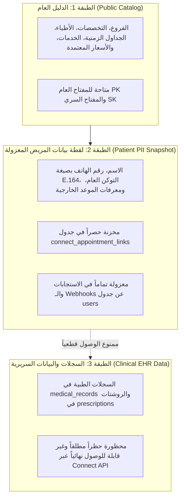

# دليل التكامل والربط البرمجي — منصة طبيبي (Tebiby Connect API)
## وثيقة المواصفات الفنية الشاملة والمعمارية المقاومة للأخطاء (Enterprise Resilient Architecture RFC)

> **الإصدار:** 2.4.0 (Technical RFC & Implementation Blueprint - Pending Client Sign-Off)  
> **التاريخ:** نوفمبر 2026  
> **الحالة:** مسودة مواصفات فنية قيد المراجعة والاعتماد (Technical RFC & Implementation Blueprint - Pending Client Sign-Off)  
> **المرجعية النظامية:** نظام حماية البيانات الشخصية السعودي (PDPL) واللوائح الصحية المعتمدة.  
> **وثائق الشركاء والتدقيق الملحقة:**
> - [REPO_AUDIT_4.md](file:///g:/Web/Projects/freelancer/tebbi/REPO_AUDIT_4.md) (تقرير التدقيق الفعلي 4: جداول الدكاترة، الفترات، خدمات الأطباء، ومحرك الطابور الحي)
> - [REPO_AUDIT_3.md](file:///g:/Web/Projects/freelancer/tebbi/REPO_AUDIT_3.md) (تقرير التدقيق الميداني الشامل 3: توليد الفترات، طابور الانتظار، إشعارات الواتساب، التوقيت، وتدقيق CI)
> - [REPO_AUDIT_2.md](file:///g:/Web/Projects/freelancer/tebbi/REPO_AUDIT_2.md) (تقرير التدقيق الفعلي للكود والتحقق الميداني من القواعد)
> - [TEBIBY_CONNECT_PARTNER_OPENAPI.md](file:///g:/Web/Projects/freelancer/tebbi/TEBIBY_CONNECT_PARTNER_OPENAPI.md) (OpenAPI 3.1 & Partner Developer Reference)
> - [docs/api/openapi.yaml](file:///g:/Web/Projects/freelancer/tebbi/docs/api/openapi.yaml) (Machine-Readable OpenAPI 3.1 Specification)

---

# فهرس المحتويات
1. [المبادئ المعمارية الجوهرية وقرارات التصميم الحاسمة](#1-المبادئ-المعمارية-الجوهرية-وقرارات-التصميم-الحاسمة)
2. [استراتيجية فصل البيانات الثلاثية وحماية الخصوصية (3-Tier Data Separation & PDPL)](#2-استراتيجية-فصل-البيانات-الثلاثية-وحماية-الخصوصية-3-tier-data-separation--pdpl)
3. [استراتيجية البيئة التجريبية وصمام الأمان ثنائي الاتجاه (Isolated Sandbox & Bidirectional Boot Guard)](#3-استراتيجية-البيئة-التجريبية-وصمام-الأمان-ثنائي-الاتجاه-isolated-sandbox--bidirectional-boot-guard)
4. [حوكمة المفاتيح ونموذج الصلاحيات المقيد وجدول التدقيق (connect_credentials, facility_wide & connect_audit_logs)](#4-حوكمة-المفاتيح-ونموذج-الصلاحيات-المقيد-وجدول-التدقيق-connect_credentials-facility_wide--connect_audit_logs)
5. [نموذج ربط البيانات الصامت (connect_appointment_links - Zero Changes to appointments)](#5-نموذج-ربط-البيانات-الصامت-connect_appointment_links---zero-changes-to-appointments)
6. [محول الحجز وتوليد هوية المريض التقنية (BookingAdapter, Shared Phone Safety & Client Decision)](#6-محول-الحجز-وتوليد-هوية-المريض-التقنية-bookingadapter-shared-phone-safety--client-decision)
7. [دورة حياة جلسة الحجز الموقعة والاتساق المالي (Pre-Validated Booking Intent & Pricing)](#7-دورة-حياة-جلسة-الحجز-الموقعة-والاتساق-المالي-pre-validated-booking-intent--pricing)
8. [محرك الـ Idempotency المعاملاتي المزدوج والتأكيد الذري (Two-Phase Idempotency & Split Commit Paths)](#8-محرك-الـ-idempotency-المعاملاتي-المزدوج-والتأكيد-الذري-two-phase-idempotency--split-commit-paths)
9. [آلة حالات الإلغاء والجدولة المحجوزة (Cancellation State Machine & Reserved Rescheduling)](#9-آلة-حالات-الإلغاء-والجدولة-المحجوزة-cancellation-state-machine--reserved-rescheduling)
10. [جدول مواءمة الحالات وحظر السلاسل الداخلية (Public Status Mapping Matrix)](#10-جدول-مواءمة-الحالات-وحظر-السلاسل-الداخلية-public-status-mapping-matrix)
11. [الأمان العام، التوكنات، وحماية أرقام التذاكر ومحددات السرعة (Public Lookups, Tokens, Ticket Concurrency & Rate Limiters)](#11-الأمان-العام-التوكنات-وحماية-أرقام-التذاكر-ومحددات-السرعة-public-lookups-tokens-ticket-concurrency--rate-limiters)
12. [معمارية الـ Webhooks وإدارة الأسرار وحماية SSRF (Webhooks Architecture, Deliveries & SSRF Defense)](#12-معمارية-الـ-webhooks-وإدارة-الأسرار-وحماية-ssrf-webhooks-architecture-deliveries--ssrf-defense)
13. [سياسة إشعارات الواتساب والتكامل مع أنظمة المستشفيات (WhatsApp Integration Policy)](#13-سياسة-إشعارات-الواتساب-والتكامل-مع-أنظمة-المستشفيات-whatsapp-integration-policy)
14. [سجلات التدقيق الصامتة، قناة التسجيل المعزولة واستثناءات قاعدة البيانات (Connect Log Channel, ConnectQueryException & Failed Jobs)](#14-سجلات-التدقيق-الصامتة-قناة-التسجيل-المعزولة-واستثناءات-قاعدة-البيانات-connect-log-channel-connectqueryexception--failed-jobs)
15. [البنية التحتية للمسارات وعزل استثناءات الـ API وخريطة أسباب التحقق (Host Isolation, Route Names, Validation Reason Map & RFC 7807)](#15-البنية-التحتية-للمسارات-وعزل-استثناءات-الـ-api-وخريطة-أسباب-التحقق-host-isolation-route-names-validation-reason-map--rfc-7807)
16. [خطة البوابات التنفيذية وجناح الاختبارات الميدانية الشامل (Phased Gates 1A-1/2/3 & Full Union Test Suite)](#16-خطة-البوابات-التنفيذية-وجناح-الاختبارات-الميدانية-الشامل-phased-gates-1a-123--full-union-test-suite)

---

## 1. المبادئ المعمارية الجوهرية وقرارات التصميم الحاسمة

تؤسس **Tebiby Connect v2.3** لمنظومة تكامل B2B رصينة ومحمية وفق القرارات المعمارية الحاسمة التالية:

1. **حظر تام للمساس بجدول المواعيد (`appointments`):** لن يُضاف أي عمود (مثل `is_sandbox` أو `external_id`) إلى جدول `appointments`. تُحفظ جميع بيانات الربط الخارجي، المعرفات، اللقطات الثابتة، وتوكنات التتبع العام في جدول وسيط مستقل تماماً: `connect_appointment_links`.
2. **عزل مادي كامل للبيئة التجريبية مع صمام أمان ثنائي الاتجاه وقائمة سماح صارمة (Bidirectional Boot Guard Allowlist):** بيئة الـ Sandbox هي تثبيت منفصل تماماً لنفس الكود على قاعدة بيانات مخصصة (`*_sandbox`) وعامل طابور مستقل وحظر تام للاتصال بالواتساب. وفي البيئات غير الإنتاجية (`local`, `staging`, `dev`)، يُلزم صمام الأمان الاتصال بقواعد بيانات تنتهي حصراً بـ (`_local`, `_dev`, `_staging`, `_test`) لمنع كارثة تشغيل الـ Staging على قاعدة بيانات الإنتاج.
3. **محول حجز رصين (`BookingAdapter`) يحاكي قواعد الحجز بدقة:** يعيد المحول تطبيق قواعد `BookingController::store` من قفل السعة الذري `lockForUpdate`، وحساب نسب التداخل للأوقات (Overlap Slots)، وحدود التأكيد التلقائي وقوائم الانتظار، وإصدار مرجع `TB-XX####` مشفر بـ CSPRNG، مع تكرار المحاولة عند الأقفال الميتة (`DB::transaction($cb, 3)`).
4. **مصدر التسعير المؤكد ومطابقة الأعمدة (Verified Fee Source & Parity Scope):**
   * بناءً على نتائج التدقيق الفعلي للكود في [REPO_AUDIT_2.md](file:///g:/Web/Projects/freelancer/tebbi/REPO_AUDIT_2.md):
     * تسلسل مصادر الرسوم المعتمد: `DoctorService.price` في حال تمرير خدمة نشطة، والبديل هو `DoctorProfile.consultation_fee`.
     * مطابقة الأعمدة في `appointments`:
       * `consultation_fee = Base Fee` (السعر الأساسي للكشف قبل الضريبة).
       * `discount = 0.00` (لا توجد خصومات في Connect Phase 1).
       * `tax = round(consultation_fee * 0.15, 2)` (ضريبة القيمة المضافة 15%).
       * `total_amount = consultation_fee + tax` (المبلغ الإجمالي شامل الضريبة).
   * **إلزامية تمرير `doctor_facility_id` الصريح:** كشف التدقيق أن `Appointment::creating` (`Appointment.php#L130-L151`) ينشئ تلقائياً سجل وسيط برسم افتراضي 200 ريال في حال غياب المعرف؛ لذا يلزم `BookingAdapter` بتمرير `doctor_facility_id` نشط ومصرح به صراحة لمنع تنفيذ الـ Hook الافتراضي.
   * **نطاق اختبارات التماثل والتطابق (Parity Tests Scope):** تقتصر اختبارات التماثل بين `BookingController::store()` و `BookingAdapter` صراحة على:
     1) حساب السعة وذروة التداخل الزمني (`capacity`).
     2) تحديد الحالة (`status`: مؤكد تلقائياً confirmed مقابل قائمة الانتظار booked).
     3) تخصيص رقم التذكرة المتسلسل (`ticket`).
     4) بنية مرجع الحجز العشوائي المشفر (`booking_reference`: TB-XX####).
5. **ترتيب الأقفال الصارم لمنع الأقفال الميتة (Lock Order Hierarchy):**
   $$\text{Doctor / Day Capacity (Appointment::lockForUpdate)} \longrightarrow \text{Booking Intent (ConnectBookingIntent::lockForUpdate)}$$
6. **إلزامية نية الحجز المسبقة (Intent Always Required):** إلغاء أي طريقة حجز مباشر بدون نية؛ يجب استدعاء `POST /booking-intents` أولاً للحصول على توكن موقع `bit_...`، ثم استبداله في مسار `POST /appointments`.
7. **الاتساق المالي لـ `expected_fee`:** تحديد `expected_fee` بوضوح بأنه **المبلغ الإجمالي شامل الضريبة 15% (VAT-inclusive Total Fee)** في كافة النماذج والمسارات.
8. **فصل مسارات الـ Idempotency المعاملاتية وتشفير الاستجابة بـ Laravel Crypt:**
   * مسار النجاح (2xx): يتم تحديث وتخزين استجابة الـ Idempotency المشفرة بواسطة `Crypt::encryptString()` المدعومة بمفتاح `APP_KEY` داخل نفس المعاملة (Tx2) مع الحجز بنفس الـ Commit.
   * مسار أخطاء الأعمال (4xx): يتم تراجع Tx2 بالكامل وتخزين الخطأ في كتابة منفصلة بعد الـ Rollback بمهلة قصيرة (5 دقائق).
9. **حجز إعادة الجدولة مؤقتاً واقتصار الدفع:** حجز مسار إعادة الجدولة (`Reserved`) للمرحلة القادمة، واقتصار الدفع على الدفع بالعيادة فقط (`at_clinic`).
10. **معمارية استثناءات قاعدة البيانات المعزولة كلياً وقناة التسجيل المخصصة (ConnectQueryException & Connect Channel):**
    * حظر تطبيق `->stop()` على فئة `QueryException` العامة؛ لأن `->stop()` في لارفيل 11/12 يوقف تقارير الأخطاء عالمياً على مستوى التطبيق بالكامل مما يعمي لوحات التحكم والويب عن أخطاء الـ SQL.
    * الحل المعتمد: اصطياد `QueryException` داخل مسارات ومحولات Connect وإعادة إطلاقها كاستثناء مخصص `ConnectQueryException`، وتطبيق `->stop()` حصراً على هذه الفئة المخصصة مع توجيه السجل المطهر إلى قناة التسجيل المستقلة `connect`.
    * شطب استعلامات SQL واستبدالها بـ `[REDACTED_SQL]` وحجب كافة الـ Bindings.
    * بقاء تقارير أخطاء الـ Web والداشبورد تعمل بطبيعتها الأصلية 100% دون أي تغيير.
    * توليد البريد التقني بنطاق داخلي آمن `@connect-patient.tebiby.internal` مستثنى من الإرسال البريدي وبتجزئة مستقلة لا تحتوي على `APP_KEY`.
    * توثيق بنية الكاش على قاعدة البيانات (`database` cache store) مع التوصية بـ Redis للبنى عالية التحميل.

---

## 2. استراتيجية فصل البيانات الثلاثية وحماية الخصوصية (3-Tier Data Separation & PDPL)

لحماية خصوصية المرضى والامتثال للأنظمة الصحية ونظام حماية البيانات الشخصية السعودي (PDPL)، تُقسم بيانات المنصة إلى ثلاث طبقات صارمة:



### ضوابط تصنيف البيانات الحساسة وملاحظات المريض:
1. **التحقق من جداول المنظومة السريرية الحالية (Clinical Tables in Repo):**
   * توجد السجلات السريرية في جدولي `medical_records` (يمثله الموديل `App\Models\MedicalRecord`) و `prescriptions` (يمثله الموديل `App\Models\Prescription`).
   * **حظر التعاقد (Contract Guard):** يُحظر حظراً تاماً تضمين أي علاقات أو استعلامات تخص `MedicalRecord` أو `Prescription` داخل نطاق مسارات Connect API.
2. **حالة حقول الملاحظات وأسباب الإلغاء (Pending Client Approval):**
   * إن استبقاء حقلي `patient_notes` في إنشاء الحجز و `cancellation_reason` في الإلغاء هو **قيد اعتماد العميل النهائي (Pending Client Approval)**.
   * في حال اعتمادهما من العميل، تُطبق الضوابط المشددة التالية:
     * **الحد الأقصى:** 500 حرف كحد أقصى لكل حقل.
     * **شطب السجلات (Log Redaction):** يُشطب محتوى الحقلين بالكامل في `connect_api_logs` وفي معالج الاستثناءات ويُستبدل بـ `[REDACTED_HEALTH_DATA]`.
     * **حظر البث في الـ Webhooks (Zero Webhook Leakage):** لا يتم بث أي من الحقلين نهائياً في أحداث الـ Webhooks لتفادي تسريب بيانات تشخيصية لخوادم غير مجهزة.
     * **أمثلة محايدة تماماً في التوثيق:** تُستخدم نصوص إدارية عامة مثل `"مراجعة دورية"` و `"طلب المريض - ظروف خاصة"`.

---

## 3. استراتيجية البيئة التجريبية وصمام الأمان ثنائي الاتجاه (Isolated Sandbox & Bidirectional Boot Guard)

### 1. صمام الأمان البرمجي ثنائي الاتجاه وقواعد البيئات (Bidirectional Boot Guard):
يُسجل صمام أمان في `AppServiceProvider::boot()` يتحقق من اتساق البيئة وقاعدة البيانات عبر قائمة سماح صارمة (Allowlist):
```php
public function boot(): void
{
    $env = app()->environment();
    $dbName = (string) config('database.connections.' . config('database.default') . '.database');

    // 1. قاعدة البيئة التجريبية (Sandbox): يجب أن تنتهي قاعدة البيانات بـ _sandbox حصراً
    if ($env === 'sandbox') {
        if (!str_ends_with(strtolower($dbName), '_sandbox')) {
            throw new \RuntimeException(
                "FATAL BOOT GUARD: Sandbox environment must run on a database ending with '_sandbox'. Connected to: [{$dbName}]"
            );
        }
    }

    // 2. قاعدة بيئة الإنتاج (Production): يُحظر الاتصال بأي قاعدة بيانات تنتهي بـ _sandbox أو _test أو _local أو _dev أو _staging
    if ($env === 'production') {
        if (preg_match('/(_sandbox|_test|_mock|_local|_dev|_staging)$/i', $dbName)) {
            throw new \RuntimeException(
                "FATAL BOOT GUARD: Production environment MUST NOT connect to a test/sandbox/local/dev/staging database: [{$dbName}]"
            );
        }
    }

    // 3. قاعدة البيئات غير الإنتاجية (Local / Dev / Staging / Testing) — قائمة سماح صارمة (Strict Allowlist):
    // يمنع نهائياً تشغيل الـ Staging أو Local على أي قاعدة بيانات إنتاجية (Staging-on-Production-DB Disaster Risk)
    if (in_array($env, ['local', 'staging', 'development', 'testing'])) {
        if (!preg_match('/(_local|_dev|_staging|_test)$/i', $dbName)) {
            throw new \RuntimeException(
                "FATAL BOOT GUARD: Non-production environment [{$env}] MUST connect to an explicitly allowed database ending with '_local', '_dev', '_staging', or '_test'. Connected to: [{$dbName}]. Connection aborted to prevent accidental destruction or corruption of production data."
            );
        }
    }
}
```

> **توثيق مخاطر الـ Staging على قاعدة الإنتاج (Staging-on-Production-DB Risk):**  
> في البيئات السحابية المشتركة، إذا وُجهت بيئة الـ Staging خطأً إلى قاعدة بيانات الإنتاج الحية، فإن القوائم المحظورة الهشة (Blocklists التي تبحث عن `_prod` أو `tebiby_live`) تفشل إذا كان اسم قاعدة البيانات العامة حيادياً (مثل `tebiby_db` أو `hospital_main`). يضمن مبدأ قائمة السماح الصارمة (Allowlist) رفض إقلاع خادم الـ Staging أو التطوير تماماً ما لم تكن قاعدة البيانات موسومة صراحة بلاحقة مسموحة (`_staging` أو `_dev` أو `_local` أو `_test`).

### 2. تصفير وإعادة تعبئة البيئة التجريبية (`POST /v1/connect/sandbox/reset`):
* المسار مسجل **حصراً** عندما يكون `APP_ENV=sandbox` (يرجع 404 في الإنتاج).
* يمسح جداول: `appointments`, `connect_appointment_links`, `connect_booking_intents`, `connect_idempotency_keys`, `connect_webhook_outbox`, `connect_webhook_logs`, `connect_api_logs`.
* يُبقي على `connect_credentials` ونقاط الـ Webhooks المسجلة للشريك.
* يُعيد حقن الدليل التجريبي عبر `SandboxCatalogSeeder`.

---

## 4. حوكمة المفاتيح ونموذج الصلاحيات المقيد (connect_credentials & facility_wide Scope)

### 1. بنية جدول المفاتيح `connect_credentials`
* `id` (bigint unsigned PK).
* `owner_type` (string: `App\Models\Group` أو `App\Models\Facility`).
* `owner_id` (unsignedBigInteger).
* `environment` (`enum('live', 'sandbox')`).
* `integration_name` (string 100).
* `pk_prefix` (string 32, nullable: بادئة المفتاح العام مثل `tb_live_pk_...`).
* `sk_hash` (string 64, unique: تجزئة SHA-256 للمفتاح السري).
* `scopes` (json: مصفوفة الصلاحيات المخصصة لكل فرع مصرح به صراحة):
  ```json
  {
    "10": ["read", "book", "cancel", "webhooks", "facility_wide"],
    "12": ["read"]
  }
  ```
* `allowed_domains` (json: قائمة النطاقات المسموح بها لترويسات CORS).
* `status` (`enum('active', 'suspended', 'revoked')`, default `'active'`).
* `expires_at` (timestamp, nullable).
* `last_used_at` (timestamp, nullable).
* `created_at`, `updated_at` (timestamps).

### 2. ضوابط الصلاحية الموسعة (`facility_wide` Scope Definition):
* **الاسم المعتمد رسمياً:** `facility_wide` (تم توحيده كاسم قياسي وحيد وحذف أي مسميات بديلة).
* **الفئات المؤهلة لمنح الصلاحية:** تُمنح حصراً للشركاء الإداريين المعتمدين للمستشفى (مثل أنظمة الـ HIS المركزية وإدارات التشغيل)، **ولا تُمنح إطلاقاً لتطبيقات حجز المريض أو الوسطاء التجاريين**.
* **موافقة خطية صريحة مسبقة من العميل (Explicit Client Approval Required):** يُشترط صدور اعتماد رسمي وموافقة خطية منفصلة لكل مفتاح `credential_id` قبل تفعيل هذا النطاق في قاعدة البيانات؛ ويُحظر تفعيله افتراضياً.
* **مخاطر إعادة التعرف المتبقية (Residual Re-identification Risk):**
  على الرغم من أن كافة أحداث الـ Webhooks والاستعلامات المندرجة تحت هذا النطاق **تُجرد تماماً من البيانات الشخصية الصريحة PII** (لا يُرسل الاسم أو الهاتف)، إلا أن هناك خطراً متبقياً لإعادة التعرف على هوية المريض (Re-identification) إذا قام الشريك أو جهة متلقية بربط الثلاثية التشغيلية `[رقم التذكرة ticket_number + وقت وتاريخ الموعد + معرف الطبيب/التخصص]` مع سجلات صالة الاستقبال الفيزيائية، كشوفات التوقيع الورقية، أو كاميرات المراقبة بالعيادة. لذا تُعامل هذه الصلاحية بحذر أمني فائق.
* **سجلات التدقيق المشددة ومنح الصلاحيات (Audit Grants & Elevated Logging):**
  * تخضع أي عملية استعلام أو حدث Webhook يستفيد من صلاحية `facility_wide` لتسجيل إلزامي في جدول `connect_audit_logs` متضمناً: معرف المفتاح `credential_id`، النطاق الزمني للمواعيد، عدد السجلات المسترجعة، عنوان IP للطلب، ومعرف التتبع `request_id`.
  * إمكانية سحب الصلاحية فورياً (`revoke`) دون تعطيل المفتاح نفسه للعمليات الاعتيادية.

### 3. بنية وسياسة جدول سجلات التدقيق (`connect_audit_logs` Schema & Retention):
يُنشأ جدول `connect_audit_logs` لتوثيق وتتبع العمليات الحساسة (مثل استعلامات `facility_wide` والوصول للدليل والأحداث):
* **الحقول البرمجية المعتمدة (Schema):**
  * `id` (`bigint unsigned auto_increment primary key`).
  * `credential_id` (`foreignId -> connect_credentials`, cascadeOnDelete, indexed).
  * `action` (`string 50`, indexed: مثل `facility_wide.query`, `facility_wide.webhook`, `catalog.read`, `availability.read`).
  * `scope` (`string 50`: `facility_wide`, `read`, etc.).
  * `records_count` (`unsignedInteger`, default 0).
  * `ip_hash` (`string 64`: تجزئة SHA-256 لعنوان IP المريض/الشريك مع ملح دوري لمنع تخزين الـ IP الصريح امتثالاً لـ PDPL).
  * `request_id` (`string 64`, indexed: معرف التتبع الفريد الصادر من الخادم).
  * `created_at` (`timestamp`, indexed).
* **سياسة الاستبقاء والحذف الدوري (Retention & Automated Purge):**
  * **فترة الاستبقاء:** 90 يوماً فقط (Retention = 90 Days) لضمان عدم تضخم قاعدة البيانات.
  * **الأمر المجدول:** أمر كونسول رسمي `php artisan connect:purge-audit-logs --days=90` يُجدول يومياً في `routes/console.php` بحذف كافة السجلات الأقدم من 90 يوماً.

---

## 5. نموذج ربط البيانات الصامت وواقع لوحات التحكم (connect_appointment_links & Dashboard Reality)

لحماية كود ولوحات تحكم المنصة الحالية بنسبة 100%، لن يطرأ أي تغيير على بنية جدول `appointments`. يتم ربط كافة عمليات التكامل عبر جدول `connect_appointment_links`:

* `appointment_id` (foreignId -> `appointments`, cascadeOnDelete, **UNIQUE**).
* `credential_id` (foreignId -> `connect_credentials`, cascadeOnDelete, indexed).
* `external_appointment_id` (string 100, nullable): `UNIQUE(['credential_id', 'external_appointment_id'])`.
* `external_patient_id` (string 100, nullable, indexed).
* `patient_name_snapshot` (string 255): لقطة ثابتة لاسم المريض وقت الحجز.
* `patient_phone_snapshot` (string 30): لقطة ثابتة لرقم جوال المريض بصيغة E.164 الدولية.
* `public_token_hash` (string 64, **UNIQUE**, indexed): تجزئة SHA-256 للتوكن العام (`ptk_...`).
* `public_token_expires_at` (timestamp, indexed): تاريخ انتهاء صلاحية التوكن العام (`appointment_date + 1 day`).
* `cancellation_reason` (string 500, nullable): سبب الإلغاء المشفر والمحمي من التدقيق (Pending client approval).

### واقع قراءة اسم المريض في لوحات التحكم الحالية (Dashboard Reality verified in REPO_AUDIT_2 & REPO_AUDIT_3):
* **حقيقة الكود القائم واستحالة تأثير الـ Accessor منفرداً:**
  * أثبت التدقيق الميداني في [REPO_AUDIT_2.md](file:///g:/Web/Projects/freelancer/tebbi/REPO_AUDIT_2.md) (القسم 7) و [REPO_AUDIT_3.md](file:///g:/Web/Projects/freelancer/tebbi/REPO_AUDIT_3.md) أن شاشات الاستقبال ولوحات الأطباء والإدارة الحالية في واجهة React/Inertia (`resources/js/...`) تقرأ خاصية الاسم مباشرة من الكائن الممرر:
    `appointment.patient?.name` (أي من كائن المستخدم المرتبط في جدول `users`).
  * **توثيق قيود المعمارية (No Zero-Code Accessor Effect):** إضافة ميثود Accessor في موديل `Appointment` (مثل `patient_display_name`) **لن يكون له أي أثر على الإطلاق في الواجهة المرئية** دون إجراء تعديلات برمجية متزامنة تشمل:
    1. إضافة الحقل إلى `$appends` في الموديل أو تمريره صراحةً في حمولة Inertia props.
    2. تحميل علاقة `connectLink` مسبقاً (Eager Loading) عبر استعلامات لوحة التحكم لضمان تحميل اللقطة.
    3. تعديل مكونات React TSX في الواجهة لقراءة `appointment.patient_display_name` بدلاً من `appointment.patient.name`.
* **الحل المعماري المعتمد (Phase 1 Invariant):**
  * **خط الأساس الثابت للمرحلة الأولى:** بما أن معيار التطوير يفرض عدم المساس بكود الواجهات ولوحات التحكم الحالية (Zero Code Changes to Dashboards)، فإن لوحات الاستقبال والأطباء ستستمر في عرض `users.name` كما هي دون تغيير. وتُحفظ اللقطة `patient_name_snapshot` في جدول `connect_appointment_links` كمرجع تعاقدي وتدقيقي ثابت يُستخدم في ردود Connect API واستجابات الـ Webhooks وعمليات المطابقة (Reconciliation).

---

## 6. محول الحجز وتوليد هوية المريض التقنية (BookingAdapter, Shared Phone Safety & Client Decision)

### 1. قسم القرار المعماري لمطابقة حسابات المرضى وتكلفة الخيار أ:
يحتوي جدول `appointments` الحالي على قيد أجنبي غير فارغ `foreignId('patient_id')->constrained('users')`.

#### تكلفة الخيار أ السابق (User Table Bloat & Dashboard Fragmentation):
* إنشاء حساب تقني جديد لكل حجز يؤدي إلى:
  1) **تضخم جدول المستخدمين (User Table Bloat):** نمو خطي مستمر بآلاف الحسابات التقنية غير المستغلة.
  2) **تشتت السجل الطبي في لوحات التحكم (Dashboard History Fragmentation):** إذا حجز نفس المريض 5 مرات عبر المستشفى الخارجي، يظهر لموظف الاستقبال والطبيب في لوحة التحكم كـ 5 مرضى مختلفين، مما يُفقد العيادة تتبع تاريخ المريض.

#### المقترح المطور (حساب تقني ثابت لكل مريض شريك - One Technical User per Partner Patient):
* **الآلية المطورة:** بدلاً من حساب لكل حجز، يقوم المحول بالبحث عن أو إنشاء حساب تقني مقيد بـ:
  $$\text{UNIQUE}(\text{credential\_id}, \text{external\_patient\_id})$$

* **تطبيع الأسماء العربية قبل المقارنة (Arabic Name Normalization):**
  * قبل إجراء أي مقارنة لأسماء المرضى لكشف التعارض، يتم تطبيع النص العربي لتفادي الأخطاء الإملائية الشائعة:
    1) إزالة علامات التشكيل والتنوين بالكامل (`Tashkeel stripping`).
    2) توحيد كافة صور الهمزة (`أ`, `إ`, `آ`) إلى ألف مجردة (`ا`).
    3) توحيد الألف المقصورة (`ى`) إلى ياء (`ي`).
    4) توحيد التاء المربوطة (`ة`) إلى هاء (`ه`).
    5) حذف المسافات الزائدة والمتكررة وتجريد علامات الترقيم.

* **قواعد فض التعارض وتثبيت الهوية عند توفر `external_patient_id`:**
  * إذا أرسل الشريك معرف مريض خارجي `external_patient_id` مسجلاً مسبقاً لنفس المفتاح `credential_id`، ولكن ورد الطلب برقم هاتف مغاير أو اسم مريض مختلف (بعد التطبيع) عن المسجل في لقطة المريض السابقة:
    * **يُرفض الطلب فوراً بكود `409 Conflict` والرمز `ERR_PATIENT_IDENTITY_CONFLICT`**.
    * الرسالة المعتمدة: `"المعرف الخارجي للمريض مسجل مسبقاً بهوية أو رقم هاتف مختلف؛ تعديل الهوية محظور."`.
    * الهدف: منع اختطاف الحسابات (Account Hijacking) ومنع دمج ملفات وسجلات مرضى مختلفين داخل العيادة بالخطأ.

### 2. مخاطر السلامة السريرية للهواتف المشتركة وخيارات العميل الحاسمة (Clinical Safety Risk & Client Decision):
* **الخطر السريري الداهم (Severe Clinical Safety Hazard):**
  في العيادات الطبية، ترتبط السجلات الطبية والتشخيصات والحساسية الدوائية والروشتات السابقة بحساب المستخدم `patient_id` (`users.id`). في حال مشاركة أفراد الأسرة (الأب، الأم، الأبناء) لنفس رقم الجوال، إذا قام النظام بدمجهم في حساب تقني واحد بناءً على رقم الهاتف المجرد:
  * ستختلط السجلات الطبية للطفل مع سجلات والده في شاشة الطبيب (`active-session` و `medical-records`).
  * قد يرى الطبيب حساسية لأدوية تخص الأب ويحجب علاجاً ضرورياً عن الطفل، أو العكس بصرف جرعات خاطئة، وهو ما يشكل **خطراً سريرياً جسيماً يهدد سلامة المريض (Critical Patient Safety Hazard)**.
* **مخاطر الالتفاف على كشف التعارض (Bypass Risk):**
  إذا تم الربط التلقائي عبر الهاتف، يمكن للشريك الالتفاف على فحص `409 ERR_PATIENT_IDENTITY_CONFLICT` ببساطة عن طريق **حذف أو إغفال المعرف الخارجي `external_patient_id`**، مما يجعل النظام يدمج المرضى قسراً على الهاتف.

#### الخيارات الثلاثة المعروضة على العميل للاعتماد النهائي (3 Client Decision Options):
1. **الخيار الأول (الموصى به بشدة للمرحلة الأولى - العزل السريري وإلزامية المعرف الخارجي / Clinical Isolation & Mandatory external_patient_id):**
   * ينشئ Connect حساباً تقنياً مستقلاً ومحدداً حصراً بالزوج الفريد:
     $$\text{UNIQUE}(\text{credential\_id}, \text{external\_patient\_id})$$
   * **إلزامية `external_patient_id` في المرحلة الأولى (Mandatory in Phase 1):** يُشترط وجود حقل `external_patient_id` في حمولة طلب الحجز `POST /appointments` والتحقق منه برمجياً (`required|string|max:100`). وغيابه يؤدي فوراً إلى رفض الطلب بكود **`422 ERR_VALIDATION_FAILED`**.
   * **الأثر المعماري الحاسم:** هذا الإلزام يقضي تماماً على تشتت الحسابات التقنية غير المرتبطة (Eliminates unlinked fallback fragmentation)، ويمنع عشوائية الحسابات المتكررة للهاتف الواحد، ويضمن استقرار ملف المريض لدى الشريك والعيادة.
   * **يُحظر تماماً الربط التلقائي بالهاتف** لحسابات مرضى الويب أو العيادة الحالية.
2. **الخيار الثاني (الربط المشروط بالتحقق المشدد من الاسم فقط / Strict Verification Linkage):**
   * يُسمح بربط الهاتف المشترك فقط إذا تطابق الاسم بعد التطبيع بنسبة $\ge 85\%$ مع صاحب الحساب التقني القائم لنفس المفتاح.
   * **حظر تام للهوية الوطنية وتاريخ الميلاد:** امتثالاً لمبدأ تقليل البيانات الصارم في PDPL، ولأن مخطط المرحلة الأولى لا يدعم الهوية الوطنية أو تاريخ الميلاد، يقتصر الفحص حصراً على خوارزمية تطبيع الأسماء العربية ونسبة التطابق اللفظي. وفي حال اختلاف الاسم، يُرفض الطلب فوراً بكود `409 Conflict` ورمز `ERR_PATIENT_IDENTITY_CONFLICT`.
3. **الخيار الثالث (حسابات التابعين الصريحة / Dependent Sub-Profiles):**
   * إلزام الشريك بإرسال حقل `dependent_id` أو `sub_profile_id` عند مشاركة الهاتف، بحيث تُميز العيادة التابع داخل الملف العائلي مستقبلاً.

### 3. محددات محول الحجز الصارمة (BookingAdapter Invariants):
1. **حظر تسجيل الدخول التلقائي:** يُحظر تماماً استدعاء `Auth::login($patient)` في أي مسار من مسارات Connect API (بخلاف سلوك حجز الويب).
2. **حظر قبول الهوية الوطنية:** يُحظر حظراً باتاً قبول أو تخزين `patient_national_id` في Connect Phase 1 امتثالاً لمبدأ تقليل البيانات في نظام PDPL.
3. **إلزامية `doctor_facility_id` الصريح:** يمرر المحول دائماً معرف `doctor_facility_id` نشط ومصرح به صراحة لمنع تنفيذ الـ Hook التلقائي في `Appointment::creating` الذي ينشئ منشأة برسم 200 ريال.

### 4. بناء البريد الإلكتروني التقني وتأمين التدوير (Hashed Technical Email):
* **نطاق البريد المعتمد:** استخدام نطاق داخلي آمن ومحجوز: `@connect-patient.tebiby.internal` (أو نطاق RFC 6761 المحجوز `.invalid` مثل `@tebiby.invalid`).
* **استبعاد مفتاح التطبيق `APP_KEY` من التجزئة:**
  * **يُحظر تماماً إدخال `config('app.key')` في تجزئة البريد التقني؛** لأن تدوير المفتاح (`key:generate`) سيغير البريد الإلكتروني لكافة المرضى، مما يخلق حسابات جديدة مكررة ويفتت السجل الطبي للمريض في لوحات الأطباء.
  * يتم اشتقاق التجزئة حصراً من معرف الشريك والمعرف الخارجي للمريض (أو الهاتف):
    ```php
    // تجزئة ثابتة ومستقرة لا تتأثر بتدوير APP_KEY
    $identityKey = $credentialId . ':' . ($externalPatientId ?? $normalizedPhone);
    $emailHash = substr(hash('sha256', $identityKey), 0, 32); // 32 hex = 128-bit entropy (zero practical collision)
    $technicalEmail = "connect-patient-{$emailHash}@connect-patient.tebiby.internal";
    ```
* **استثناء الحسابات التقنية من الإرسال البريدي (Skip Mail Sending):**
  * توثيق قاعدة برمجية قطعية: كافة قنوات الإرسال البريدي (مثل إشعارات استعادة كلمة المرور، رسائل الترحيب، النشرات البريدية) **يجب أن تتخطى الحسابات التقنية تماماً**:
    ```php
    if (str_ends_with($user->email, '@connect-patient.tebiby.internal')) {
        return; // حظر إرسال أي بريد للحسابات التقنية
    }
    ```

---

## 7. دورة حياة جلسة الحجز الموقعة والاتساق المالي (Pre-Validated Booking Intent & Pricing)

### 1. الاتساق المالي وحساب الضريبة:
* يُعرّف حقل `expected_fee` في كافة الوثائق والمسارات بأنه **المبلغ الإجمالي النهائي شامل ضريبة القيمة المضافة 15% (VAT-inclusive Total Fee)** بالريال السعودي.
* **مثال التسعير المتطابق عبر كافة المسارات:**
  * سعر الكشف الأساسي (`base_fee`): `250.00 SAR`.
  * نسبة الضريبة (`vat_rate`): `0.15` (15%).
  * قيمة الضريبة (`vat_amount`): `37.50 SAR`.
  * السعر الإجمالي المعتمد (`total_fee` / `expected_fee`): `287.50 SAR`.
  * حقل الدفع في رد الحجز النهائي (`payment.amount`): `287.50 SAR`.

### 2. دورة حياة وصلاحية نية الحجز (`POST /booking-intents`):
* **فترة الصلاحية الدقيقة (15 Minutes from Creation):**
  تُحسب مهلة انتهاء التوكن حصراً كـ **15 دقيقة من لحظة إنشاء نية الحجز**:
  $$\text{expires\_at} = \text{created\_at} + 15 \text{ minutes}$$
  *(ولا ترتبط بوقت أو تاريخ الموعد الطبي نهائياً).*
* **فحص جدول الدوام والخدمة:**
  * التحقق من وقوع الموعد داخل جدول دوام الطبيب النشط (`DoctorSchedule`) وعدم وقوعه في الماضي (`ERR_SLOT_OUTSIDE_SCHEDULE`).
  * التحقق من تبعية الخدمة للطبيب والمنشأة (`ERR_SERVICE_MISMATCH`).
  * التحقق من مطابقة السعر مع `expected_fee` (`ERR_PRICE_MISMATCH`).
* **تخزين التوكن بالتجزئة:** يُخزن التوكن كنص مجزأ `token_hash = hash('sha256', $plainToken)`.

---

## 8. محرك الـ Idempotency المعاملاتي المزدوج والتأكيد الذري (Two-Phase Idempotency & Split Commit Paths)

### 1. فصل مسارات المعالجة والتأكيد (Split Commit Paths):
لتفادي بقاء المفاتيح معلقة أو حدوث حجوزات مكررة عند انهيار الخادم:
* **المعاملة 1 (Tx1):** حجز المفتاح كـ `in_flight` وتثبيته فوراً بـ Commit مستقل.
* **مسار النجاح (Success Path - 2xx):**
  إنشاء سجل الموعد، سجل الرابط، تذكرة الانتظار، حدث الـ Outbox، وتحديث سجل الـ Idempotency (`status = 'completed'` وتخزين جسم الاستجابة المشفر) **تتم جميعها داخل المعاملة الثانية (Tx2) وتُؤكد في نفس الـ Commit الذري الواحد**.
  * إذا انهار الخادم أثناء Tx2، تتراجع المعاملة بالكامل ولا يُحفظ الموعد ولا الاستجابة، ويُحذف القفل لتمكين العميل من إعادة المحاولة بأمان.
  * إذا نجح الـ Commit ولكن انقطع اتصال الشبكة قبل استلام الرد (Lost HTTP Response)، فإن إعادة العميل للطلب بنفس المفتاح تُرجع فورياً الاستجابة الأصلية المخزنة مصحوبة بترويسة `Idempotent-Replay: true`.
* **تشفير استجابة الـ Idempotency عبر Laravel Crypt ومفتاح APP_KEY:**
  * يتم تشفير حمولة الاستجابة المخزنة في `connect_idempotency_keys.response_body` باستخدام واجهة التشفير الرسمية في لارفيل **`\Illuminate\Support\Facades\Crypt::encryptString()`** المدعومة بمفتاح التطبيق **`APP_KEY`** (خوارزمية `AES-256-CBC` أو `AES-128-CBC` بحسب إعدادات `config/app.php`)، وليس عبر مكتبة أو خوارزمية غير قياسية.
* **آثار تدوير مفتاح التطبيق (Key-Rotation Implications & Mitigation):**
  * عند تدوير مفتاح التطبيق `APP_KEY` (مثل تنفيذ أمر `php artisan key:generate`)، تصبح كافة الاستجابات المخزنة مشفرة بالمفتاح القديم وغير قابلة للفك، مما يؤدي إلى إطلاق استثناء `\Illuminate\Contracts\Encryption\DecryptException` عند محاولة إعادة إرسال الطلب (Replay).
  * **استراتيجية التخفيف:**
    1) يُبرمج الـ Middleware المخصص للـ Idempotency لاصطياد `DecryptException` والتعامل مع السجل كأنه مفتاح منتهي الصلاحية وحذفه بأمان لتجنب التسبب في خطأ 500 للشريك.
    2) أو تشغيل أمر التفريغ الدوري `php artisan connect:idempotency-purge` قبل تنفيذ تدوير المفتاح لتنظيف كافة السجلات المكتملة مسبقاً.
* **مسار أخطاء الأعمال (Business Error Path - 4xx):**
  عند حدوث خطأ أعمال (مثل امتلاء السعة `422`، انتهاء النية `410`، أو تعارض الحالة `409`):
  1) يتم عمل تراجع فوري للمعاملة `DB::rollBack()` لإلغاء أي تعديلات جزئية.
  2) **في كتابة مستقلة منفصلة بعد الـ Rollback:** يتم تحديث سجل الـ Idempotency كـ `completed` مع تخزين رد الخطأ بكاش قصير (TTL = 5 دقائق) لمنع تكرار استهلاك موارد السيرفر عند إعادة إرسال نفس الطلب المرفوض.
* **مسار أخطاء الخادم غير المتوقعة (Server Error Path - 5xx):**
  يتم عمل تراجع للمعاملة وحذف سجل الـ Idempotency فوراً (`DELETE FROM connect_idempotency_keys WHERE id = ?`) لتمكين العميل من إعادة المحاولة فورياً.

---

## 9. آلة حالات الإلغاء والجدولة المحجوزة (Cancellation State Machine & Reserved Rescheduling)

1. **إيقاف إعادة الجدولة مؤقتاً في المرحلة الأولى (Rescheduling Reserved):**
   * مسار `PATCH /v1/connect/appointments/{ref}/reschedule` موسوم كـ **محجوز للمرحلة القادمة (Reserved Endpoint)**، ويُرجع الخادم كود **`501 Not Implemented`** مع الرمز `ERR_NOT_IMPLEMENTED`.
2. **آلة حالات الإلغاء الصارمة (`POST /v1/connect/appointments/{ref}/cancel`):**
   * **الحالات المسموح بإلغائها:** المواعيد بحالة `pending_confirmation` (`booked`)، `confirmed`، أو `checked_in` (`waiting`).
   * **الحالات المحظورة:** إذا كان الموعد في حالة `in_progress` (`in_consultation`) أو `completed`، يُرفض الطلب فوراً بكود `409 Conflict` مع إرجاع `ERR_INVALID_STATE`.
   * **الموثوقية ومنع التكرار (Idempotent Cancellation):** إذا كان الموعد ملغياً بالفعل مسبقاً (`status === 'cancelled'`)، يُرجع النظام نجاحاً فورياً بكود `200 OK` بالحالة الحالية الملغاة، **دون إطلاق أي أحداث Webhook متكررة**.

---

## 10. جدول مواءمة الحالات وحظر السلاسل الداخلية (Public Status Mapping Matrix)

تلتزم كافة الـ Resources وأحداث الـ Webhooks بجدول المواءمة التالي لحظر كشف السلاسل السريرية الداخلية:

| الحالة الداخلية في قاعدة البيانات (`appointments.status`) | الاسم العام المعتمد في API والـ Webhooks (`public_status`) | الوصف الدلالي الموجه للشريك الخارجي |
| :--- | :--- | :--- |
| `booked` | `pending_confirmation` | الموعد مسجل في قائمة الانتظار وبانتظار تأكيد إدارة المنشأة. |
| `confirmed` | `confirmed` | الحجز مؤكد رسمياً وبانتظار حضور المريض في الموعد المحدد. |
| `waiting` | `checked_in` | المريض وصل صالة الاستقبال بالعيادة وحصل على تذكرة انتظار حية. |
| `in_consultation` | `in_progress` | المريض داخل غرفة الفحص السريري مع الطبيب المعالج حالياً. |
| `completed` | `completed` | اكتمل الكشف الطبي وغادر المريض العيادة وصُرفت الروشتة/التوصيات. |
| `cancelled` | `cancelled` | الموعد ملغي بناءً على طلب الشريك، أو سُجل عدم حضور (No-Show). |

---

## 11. الأمان العام، التوكنات، وحماية أرقام التذاكر ومحددات السرعة (Public Lookups, Tokens, Ticket Concurrency & Rate Limiters)

### 1. القرار المعماري لتسلسل أرقام التذاكر وحالة السباق المتبقية (Ticket Sequencing Decision):
* **القرار المعتمد:** **قبول حالة السباق المتبقية الموثقة مع حجز الويب والاستقبال (Option a: Accept Documented Residual Race)** لحين صدور موافقة خطية صريحة من العميل بإجراء تعديل طفيف على كود `BookingController::store()` و `FacilityDashboardController::storeWalkIn()`.
* **التحليل الفني وحذف الخيارات البديلة:**
  * تم استبعاد وحذف مقترحي (قفل `DoctorSchedule` وجدول `connect_ticket_sequences`)؛ حيث أثبت التحقيق الميداني أن أياً منهما **لا يحمي إطلاقاً ضد حجز الويب أو الاستقبال**، لأن كود الويب القائم يحسب التذكرة عبر `$todayTicketsCount = QueueTicket::whereHas(...)->count() + 1` دون حيازة قفل سعة على جدول المواعيد أو جدول الدوام أو أي جدول تتابعي.
* **سلوك المنظومة المعتمد:**
  1) حجوزات Connect المتزامنة فيما بينها **معزولة ومحمية تسلسلياً بنسبة كاملة** بفضل قفل السعة الذري `Appointment::lockForUpdate`.
  2) في حال تزامن حجز Connect في نفس الجزء من الثانية مع حجز ويب/استقبال لنفس الطبيب واليوم، قد يُسند نفس رقم التذكرة للطرفين دون إفساد حالة الموعد أو تعارضه في جدول `appointments`.
* **اختبار المخاطر المعروفة المعتمد (@group known-risk Test):**
  * تمت إضافة اختبار معتمد موسوم بـ `@group known-risk`:
    `test_queue_ticket_residual_race_with_unlocked_web_booking_known_risk()`
    يوثق ويحاكي تداخل حجز ويب غير مقفل مع حجز Connect ويؤكد بقاء حالة الحجز سليمة مع توثيق التكرار اللحظي للتذكرة لحين اعتماد العميل لقفل موحد في كود الويب.

### 2. استعلام الطابور بالتوكن العام وحالة التأخير:
* المسار: `GET /v1/connect/queue/{public_token}`.
* التوكن عبارة عن سلسلة مشفرة عشوائية بـ 32 بايت تبدأ بـ `ptk_...`، وتُخزن بتجزئة SHA-256 في `connect_appointment_links.public_token_hash` مع قيد فريد `UNIQUE`.
* ينتهي مفعول التوكن تلقائياً مع انتهاء يوم الموعد: `expires_at = appointment_date + 1 day`.
* **عرض التأخير ديناميكياً:** يُعرض حقل `delay_minutes` ورمز سبب التأخير `delay_reason_code` عبر استعلام الطابور الحي مباشرة عند تسجيل الطبيب لتأخر في العيادة. **ولا يتم إطلاق أي حدث Webhook عند التأخير في المرحلة الأولى**.

### 3. محددات السرعة المزدوجة والمستقلة لرقم الهاتف وواقع بنية الكاش (Dual Independent Phone Rate Limiters & Cache Architecture):
تتضمن المنظومة **محددين مستقلين تماماً** لرقم هاتف المريض، ويعمل كل منهما بآلية مستقلة لحماية الموارد:
1. **محدد التدفق اللحظي قصير المدى (Short-Term Burst/Flood Limiter):**
   * **الحد المسموح:** بحد أقصى **3 محاولات / دقيقة / رقم هاتف** (`phone_flood:<phone>`).
   * **واقع بنية الكاش الحالية ومحدوديتها (Database Cache Limitation):**
     * وسيط الكاش المعتمد في المشروع حالياً هو **قاعدة البيانات (`CACHE_STORE=database`)** داخل جدول `cache`، **ولا يوجد Redis في البنية الحالية**.
     * تشغيل محدد التدفق عبر كاش قاعدة البيانات يؤدي إلى استهلاك عمليات I/O وتنافس أقفال لحظي (Row Contention) على جدول `cache` عند تزامن طلبات مكثفة.
     * **المتطلب الأساسي للإنتاج (Infrastructure Prerequisite):** يُعد توفير خادم **Redis** متطلباً بنيوياً أساسياً (Prerequisite) في بيئة الإنتاج عالية الأحمال لضمان خنق الطلبات في الذاكرة (In-Memory) بأقل من 1 ميلي ثانية ودون إثقال قاعدة البيانات.
   * **الاستجابة عند التجاوز:** كود `429 Too Many Requests` مع الرمز `ERR_RATE_LIMIT_EXCEEDED`.
2. **سقف الحجوزات اليومية المعتمدة وتعريف المواعيد النشطة (Daily Active Booking Quota):**
   * **الحد المسموح:** بحد أقصى **5 حجوزات نشطة / يوم / رقم هاتف** (`phone_daily:<phone>:<date>`).
   * **التعريف الدقيق والقطعي للموعد النشط (Active Appointment Definition):**
     يُعد الموعد نشطاً ومحسوباً ضمن السقف اليومي إذا كان:
     $$\text{appointment\_date} = \text{target\_date} \quad \text{AND} \quad \text{status} \notin (\text{'cancelled'})$$
     * **الحالات المحسوبة ضمن السقف (All Active States Included):**
       تشمل كافة المواعيد بحالة `pending_confirmation` (`booked`)، `confirmed`، `checked_in` (`waiting`)، `in_progress` (`in_consultation`)، و `completed`.
     * **الاستثناء الوحيد:** المواعيد الملغاة صراحة (`status === 'cancelled'`) فقط هي التي تُستثنى ولا تُحسب ضمن السقف اليومي.
   * **الاستجابة عند التجاوز:** كود `422 Unprocessable Content` مع الرمز `ERR_DAILY_PHONE_LIMIT`.
* **الاستقلالية التامة (Complete Independence):** هذان المحددان مستقلان كلياً عن بعضهما؛ فاجتياز محدد التدفق اللحظي لا يعفي من سقف الحجوزات اليومية، وتوفر رصيد في السقف اليومي لا يسمح للعميل بتجاوز حد الـ 3 محاولات في الدقيقة الواحدة.

---

## 12. معمارية الـ Webhooks وإدارة الأسرار وحماية SSRF (Webhooks Architecture, Deliveries & SSRF Defense)

### 1. تدقيق التسليم وإدارة الأسرار:
* **مسار تدقيق سجلات التسليم (`GET /v1/connect/webhooks/{id}/deliveries?page=1`):**
  يُتيح للشريك استعراض سجلات محاولات التسليم السابقة متضمنة: معرف التسليم `delivery_id`، معرف الحدث `event_id`، الحالة، عدد المحاولات، كود الاستجابة، ووقت التسليم.
* **مسار تدوير السر (`POST /v1/connect/webhooks/{id}/rotate-secret`):**
  يُصدر سراً جديداً (`whsec_...`) مع تفعيل فترة سماح مدتها 24 ساعة؛ **ويظل السر السابق صالحاً للتحقق حتى انتهاء `grace_period_expires_at`** لتمكين الشريك من التحديث دون أي انقطاع في الاستقبال.
* **مسار إعادة الإرسال اليدوي (`POST /v1/connect/webhooks/deliveries/{delivery_id}/redeliver`):**
  يُمكن الشريك أو المشرف من إعادة جدولة إرسال محاولة تسليم فاشلة أو منقولة للـ Dead Letter فورياً.

### 2. نطاق الـ Observer المشروط والقائمة الموسعة لحماية SSRF:
* **النطاق الافتراضي الموسع:** يقتصر الـ Observer على إرسال أحداث المواعيد المرتبطة بمفتاح الشريك في `connect_appointment_links.credential_id`. وإذا كان المفتاح يمتلك صلاحية `facility_wide`، تُرسل أحداث كافة مواعيد المنشأة مجردة من هوية المريض.
* **القائمة الموسعة الصارمة لحظر الـ SSRF (SSRF Extended Blocklist):**
  يُفحص الرابط لحظة تسجيله في `POST /webhooks` ويُعاد فحصه وتثبيت الـ IP (Socket Pinning) قبل كل محاولة إرسال ضد كافة العناوين المحظورة:
  * `0.0.0.0/8` (Current network / default route).
  * `127.0.0.0/8` (IPv4 loopback).
  * `::1` (IPv6 loopback).
  * `::ffff:127.0.0.0/104` و `::ffff:127.0.0.1` (IPv4-mapped IPv6 loopback).
  * `10.0.0.0/8`, `172.16.0.0/12`, `192.168.0.0/16` (Private networks).
  * `169.254.0.0/16` (Link-local & AWS/Cloud Metadata).
  * `100.64.0.0/10` (Carrier-grade NAT).
  * `fe80::/10` (IPv6 Link-local).
  * `fc00::/7` (IPv6 Unique Local).
  * البروتوكول: HTTPS حصراً، ومنفذ 443 حصراً، حظر بيانات الاعتماد المضمنة، مهلة اتصال 5 ثوانٍ، ومنع إعادة التوجيه (`max_redirects: 0`).

---

## 13. سياسة إشعارات الواتساب والتكامل مع أنظمة المستشفيات (WhatsApp Integration Policy)

* **حالة السياسة:** قيد الاعتماد النهائي مع أصحاب المصلحة (Policy Decision Pending).
* **القيمة الافتراضية الصارمة:** الحقل الاختياري `send_whatsapp_notification` في طلب الحجز `POST /appointments` **قيمته الافتراضية هي `false`**.
* **التحقق الميداني من كبح كافة الإشعارات دورة الحياة (Field-Verified in REPO_AUDIT_3):**
  * أثبت التدقيق الميداني في [REPO_AUDIT_3.md](file:///g:/Web/Projects/freelancer/tebbi/REPO_AUDIT_3.md) (القسم 3) أن كافة الميثودات الثمانية لإرسال إشعارات الواتساب في `GupshupWhatsAppService`:
    1. `notifyAppointmentCreated`
    2. `notifyAppointmentConfirmed`
    3. `notifyAppointmentCancelled`
    4. `notifyAppointmentRescheduled`
    5. `notifyQueueProgress`
    6. `notifyTurnApproaching`
    7. `notifyNowServing`
    8. `notifyAppointmentCompleted`
  * **تحتوي جميعها دون استثناء في أول سطر تنفيذي على:**
    ```php
    if ($appointment->notify_whatsapp === false) {
        return ['status' => 'skipped', 'reason' => 'patient_opted_out'];
    }
    ```
  * وبالتالي، فإن تمرير `send_whatsapp_notification = false` في Connect يضبط `appointments.notify_whatsapp = false`، مما يضمن كبحاً تاماً وموثوقاً بنسبة 100% لكافة رسائل الواتساب طوال دورة حياة الموعد حتى لا يختلط التواصل مع رسائل الشريك أو المستشفى الخارجي.

### تنبيه أمني وتدقيق خصوصية منفصل (PII Logging in Existing Gupshup Service):
* كشف التدقيق الميداني في [REPO_AUDIT_4.md](file:///g:/Web/Projects/freelancer/tebbi/REPO_AUDIT_4.md) (القسم 5) أن خدمة `GupshupWhatsAppService` الحالية في المنصة تقوم بتسجيل رقم هاتف المستلم (`'destination' => $destination`) وجسم الاستجابة الخام في سجلات النظام (`Log::info`, `Log::warning`, `Log::error`) في الأسطر 227، 237، 245، 305، 315، 323.
* **الأثر على Connect API:** لا يؤثر هذا الخلل على Connect لأن الضبط الافتراضي `notify_whatsapp: false` يوقف التنفيذ في أول سطر بالميثود قبل استدعاء دوال الإرسال أو التسجيل. ومع ذلك، تم توثيق هذا الأمر كـ Finding منفصل لإبلاغ إدارة المنشأة بتنقيح هذه السجلات في كود التطبيق القائم حمايةً للبيانات الشخصية بموجب نظام PDPL قبل التفكير في أي تفعيل مستقبلي لإشعارات الواتساب عبر Connect.

---

## 14. سجلات التدقيق الصامتة، قناة التسجيل المعزولة واستثناءات قاعدة البيانات (Connect Log Channel, ConnectQueryException & Failed Jobs)

### 1. معمارية كبح استثناءات قاعدة البيانات الآمنة (ConnectQueryException Architecture):
* **الخلل الفني في تطبيق `->stop()` على الفئة العامة `QueryException`:**
  * في معمارية لارافيل 11/12 (`withExceptions`)، يؤدي ربط `->stop()` بأي معالج `reportable()` إلى **إيقاف سلسلة التقارير كلياً لكافة الاستثناءات من نفس الفئة عالمياً**.
  * وضع شرط مثل `if (request()->getHost() === ...)` داخل الـ Closure لا يمنع `->stop()` من كبح التقارير؛ فإذا كان الطلب قادماً من لوحة تحكم الاستقبال أو الويب ومر بالشرط دون تنفيذ البلوك، يُنهي `->stop()` تدفق التقرير، مما يؤدي إلى حجب تسجيل أخطاء قاعدة البيانات عن لوحات التحكم الإدارية والويب (`laravel.log` / Sentry).
* **المعمارية المعتمدة لحماية النظام القائم بنسبة 100%:**
  1. **ترتيب اصطياد الاستثناءات في محول الحجز (Explicit Catch Ordering in BookingAdapter):**
     * **الخطوة الأولى:** عند محاولة إدراج الموعد، يتم اصطياد `\Illuminate\Database\QueryException` ذات كود الخطأ 1062 (MySQL Duplicate Key Error / SQLState 23000) الناتجة عن تصادم الفهرس الفريد لمرجع الحجز `booking_reference` (`TB-XX####`) **أولاً وقبل أي تغليف**.
     * يقوم المحول بإعادة توليد الحرفين والأرقام العشوائية وإعادة المحاولة حتى 3 مرات.
     * **الخطوة الثانية:** في حال استنفاد المحاولات الثلاث، أو كان الاستثناء ناتجاً عن أي خطأ قاعدة بيانات آخر (غير 1062): **حينئذٍ فقط** يتم تغليف الاستثناء في `App\Exceptions\Connect\ConnectQueryException` وإعادة إطلاقه.
  2. **صمام الأمان البرمجي الثاني (Global Connect Middleware Catch):**
     * يُضاف Middleware مخصص لمجموعة Connect (`HandleConnectDatabaseExceptions`):
     * يقوم باصطياد أي استثناء `\Illuminate\Database\QueryException` قد يفلت من الطبقات الداخلية دون تغليف، ويقوم بتسجيل تفاصيله المشطوبة في قناة `connect` بنص `[REDACTED_SQL]` وبلا Bindings، ثم يُلقي `ConnectQueryException` أو يُرجع استجابة RFC 7807 (500) مباشرة.
     * يمثل هذا الوسيط خط دفاع ثانٍ يضمن عدم تسرب أي استعلام قاعدة بيانات غير معقم إلى معالج لارافيل العام.
  3. **ربط `->stop()` حصراً بالفئة المغلفة (`ConnectQueryException`):**
     في `bootstrap/app.php`:
     ```php
     ->withExceptions(function (Exceptions $exceptions) {
         // كبح تسجيل أخطاء Connect المخصصة فقط دون أي مساس بـ QueryException العامة
         $exceptions->reportable(function (\App\Exceptions\Connect\ConnectQueryException $e) {
             \Illuminate\Support\Facades\Log::channel('connect')->error('[REDACTED_SQL] Connect Database Error', [
                 'code' => $e->getCode(),
                 'error_id' => $e->getErrorId(),
                 'context_id' => $e->getContextId(),
             ]);
         })->stop(); // يوقف تقرير ConnectQueryException حصراً!
     })
     ```
     * **الأثر المعماري الحاسم:** تظل فئة `\Illuminate\Database\QueryException` العامة **غير مقيدة بـ `->stop()` نهائياً**؛ وبالتالي فإن أي خطأ استعلام في لوحة تحكم الاستقبال أو إدارة الأطباء أو حجز الويب يتدفق طبيعياً وبكامل تفاصيله والـ Bindings إلى `laravel.log` و Sentry دون أي انقطاع.

### 2. قناة التسجيل المعزولة `connect` وشطب الـ SQL (Channel Configuration & [REDACTED_SQL]):
* **تعريف القناة في `config/logging.php`:**
  تُعرف قناة مستقلة خاصة بـ Connect:
  ```php
  'connect' => [
      'driver' => 'daily',
      'path' => storage_path('logs/connect.log'),
      'level' => env('LOG_LEVEL', 'info'),
      'days' => 90,
      'replace_placeholders' => true,
  ],
  ```
* **شطب استعلامات SQL وربط المعاملات (Binding Redaction):**
  * يُحظر تماماً تمرير نصوص الاستعلامات المتضمنة للمدخلات؛ وتُلزم كافة استعلامات Connect باستخدام الـ Parameterized Bindings (`?` أو Named Bindings).
  * يقوم معالج الاستثناءات وقناة `connect` باستبدال نص أي استعلام بـ `[REDACTED_SQL]` وحجب مصفوفة الـ `bindings` بـ `[REDACTED]`.

### 3. التطهير وسياق التنفيذ في الوظائف الخلفية والكونسول (Queue Jobs & Console Context):
* **إدارة السياق بدون كائن الطلب (Context Management via ConnectContext):**
  في وظائف الطوابير (`DispatchWebhookDeliveryJob`) وأوامر الكونسول، لا يتوفر كائن `request()`؛ لذا تُدار بيانات السياق عبر فئة سياق مخصصة `ConnectContext`:
  ```php
  ConnectContext::setContext([
      'credential_id' => $job->credentialId,
      'job_id' => $job->job->getJobId(),
  ]);
  ```
* **المعمارية المعتمدة للتطهير عبر سياقات النظام:**
  1. **معالج الفشل في الوظائف (`failed()` handler in Jobs):**
     * تحتوي كافة وظائف الطابور الخاصة بـ Connect (مثل `DispatchWebhookDeliveryJob`) على ميثود `failed(\Throwable $exception): void`.
     * يقوم المعالج بتطهير رسالة الخطأ وشطب أي معطيات تشخيصية أو أسرار قبل إرسالها إلى جدول `failed_jobs` أو السجلات.
  2. **معالج السجلات العام المقيد بقناة Connect (Scoped Monolog Processor):**
     * تسجيل Monolog Processor مقيد بقناة `connect` في `config/logging.php`:
       * يقوم أوتوماتيكياً بشطب حقول `bindings` واستبدالها بـ `[REDACTED]`.
       * إذا احتوى السياق على حقول طبية أو شخصية (`patient_notes`, `cancellation_reason`, `patient_phone`)، تُشطب فوراً عبر الـ Processor.
       * لا يمس هذا المعالج سجلات لوحات التحكم أو قنوات التسجيل العامة الأخرى نهائياً.

### 4. سياسة جدول الوظائف الفاشلة (`failed_jobs` Policy):
* فئة معالجة الطابور `DispatchWebhookDeliveryJob` تقبل المعرف الرقمي فقط (`public int $outboxId`)؛ مما يضمن أن السلسلة المخزنة في جدولي `jobs` و `failed_jobs` تحتوي فقط على المعرف الرقمي وتخلو من أي نصوص أو PII.

---

## 15. البنية التحتية للمسارات وعزل استثناءات الـ API وخريطة أسباب التحقق (Host Isolation, Route Names, Validation Reason Map & RFC 7807)

### 1. عزل النطاق وتسمية المسارات الرسمية الموحدة مع OpenAPI (`connect.*` Route Names):
* يُحدد نطاق الواجهة عبر متغير البيئة `CONNECT_API_HOST`. وعندما يستقبل هذا النطاق أي طلب، **يقتصر تشغيل الخادم على مسارات `routes/connect.php` فقط** مع حظر لوحات التحكم القديمة نهائياً.
* **إلزامية تسمية المسارات ببادئة `connect.` المتوافقة كلياً مع OpenAPI 3.1:**
  تُعرف كافة المسارات في `routes/connect.php` داخل مجموعة مسماة بـ `as('connect.')`:
  * `connect.branches.index` (`GET /v1/connect/branches`)
  * `connect.specialties.index` (`GET /v1/connect/specialties`)
  * `connect.doctors.index` (`GET /v1/connect/doctors`)
  * `connect.doctors.show` (`GET /v1/connect/doctors/{doctor_id}`)
  * `connect.doctors.services` (`GET /v1/connect/doctors/{doctor_id}/services`)
  * `connect.doctors.availability` (`GET /v1/connect/doctors/{doctor_id}/availability`)
  * `connect.booking-intents.store` (`POST /v1/connect/booking-intents`)
  * `connect.appointments.store` (`POST /v1/connect/appointments`)
  * `connect.appointments.cancel` (`POST /v1/connect/appointments/{booking_reference}/cancel`)
  * `connect.appointments.reschedule` (`PATCH /v1/connect/appointments/{booking_reference}/reschedule` - Reserved)
  * `connect.appointments.reconcile` (`GET /v1/connect/appointments`)
  * `connect.queue.show` (`GET /v1/connect/queue/{public_token}`)
  * `connect.webhooks.index` (`GET /v1/connect/webhooks`)
  * `connect.webhooks.store` (`POST /v1/connect/webhooks`)
  * `connect.webhooks.show` (`GET /v1/connect/webhooks/{id}`)
  * `connect.webhooks.destroy` (`DELETE /v1/connect/webhooks/{id}`)
  * `connect.webhooks.deliveries` (`GET /v1/connect/webhooks/{id}/deliveries`)
  * `connect.webhooks.rotate-secret` (`POST /v1/connect/webhooks/{id}/rotate-secret`)
  * `connect.webhooks.redeliver` (`POST /v1/connect/webhooks/deliveries/{delivery_id}/redeliver`)
  * `connect.sandbox.reset` (`POST /v1/connect/sandbox/reset`)

### 2. التوقيت الزمني الموحد بصيغة UTC والتحقق الإقليمي (Timezone, UTC & Asia/Riyadh Validation):
* **كافة الحقول الزمنية في الاستجابات والـ Webhooks تلتزم حصراً بصيغة ISO 8601 UTC**: `YYYY-MM-DDTHH:mm:ssZ`.
* **تواريخ وأوقات المواعيد في الحمولات (`appointment_date`, `appointment_time`):** تمثل التوقيت المحلي لعيادات المملكة العربية السعودية (`Asia/Riyadh`، UTC+3) كما تم التحقق منه في REPO_AUDIT_2 و REPO_AUDIT_3.
* **فحص المواعيد الماضية الصريح:** يتم دمج التاريخ والوقت ومقارنتهما صراحةً بتوقيت الرياض: `Carbon::parse("{$date} {$time}", 'Asia/Riyadh')->isPast()`، ويُحظر استخدام `app.timezone` الافتراضي لمنع الانحراف الزمني.

### 3. خريطة أسباب أخطاء التحقق الصارمة وحظر تسريب المدخلات (Validation Rule to Reason Map):
* **حظر تام لرسائل لارفيل الافتراضية المكررة للمدخلات:**
  تقوم رسائل لارفيل الافتراضية بإعادة طباعة قيمة المدخل في نص الخطأ (مثل `"The patient_phone +966501234567 is invalid."`)، مما يؤدي لتسريب أرقام الهواتف والبيانات الشخصية داخل أجسام استجابات الأخطاء وسجلات الـ Proxy.
* **الخريطة الثابتة المعتمدة في `ConnectValidationException`:**
  يتم تحويل أخطاء التحقق إلى مصفوفة `invalid_params` باستخدام خريطة ثابتة ومجردة من قيم المدخلات:
  ```php
  $ruleToReason = [
      'required' => 'Field is required',
      'required_if' => 'Field is required under current conditions',
      'regex' => 'Invalid format',
      'date' => 'Must be a valid date in YYYY-MM-DD format',
      'date_format' => 'Invalid date format',
      'after' => 'Date must be after the specified date',
      'after_or_equal' => 'Date must not be in the past',
      'in' => 'Selected value is not permitted',
      'string' => 'Must be a string',
      'integer' => 'Must be an integer',
      'numeric' => 'Must be numeric',
      'max' => 'Value exceeds maximum allowed length',
      'min' => 'Value does not meet minimum allowed length',
      'array' => 'Must be an array',
      'exists' => 'Referenced resource does not exist',
      'unique' => 'Value has already been taken',
      'boolean' => 'Must be a boolean',
      'uuid' => 'Must be a valid UUID',
      'email' => 'Must be a valid email address',
  ];
  ```
  تضمن هذه الخريطة خلو ردود أخطاء `422 ERR_VALIDATION_FAILED` من أي بيانات شخصية PII نهائياً.
* **معالجة حالات `ValidationException::withMessages` الاحتياطية:**
  عند إطلاق الاستثناء يدوياً دون وجود مدقق كامل (حيث تكون `validator->failed()` فارغة أو غير متوفرة)، يقوم المعالج باستخراج الحقول من `$e->errors()` وتعيين سبب آمن مجرد `Invalid field value`، دون تمرير نصوص الرسائل الخام لتفادي أي تسريب للبيانات.

### 4. آلية الاستعلام التصالحي وترقيم الصفحات الموحد (Reconciliation Pagination & Fallback):
   * يدعم مسار الاستعلام التصالحي ترقيم الصفحات بحد أقصى 100 سجل في الصفحة (Default: 50):
     `GET /v1/connect/appointments?updated_since=2026-11-22T00:00:00Z&page=1&per_page=50`
   * **معامل الاحتياط باليوم الكامل:** `GET /v1/connect/appointments?date=YYYY-MM-DD&page=1&per_page=50` لمطابقة مواعيد يوم كامل في حال حدوث تحديثات مجمعة في لوحة التحكم لم تُحدث `updated_at`.
   * **هيكل الاستجابة المتوافق مع OpenAPI (data + meta):**
     ```json
     {
       "data": [
         {
           "booking_reference": "TB-SR8492",
           "external_appointment_id": "HOSP-94821",
           "status": "checked_in",
           "updated_at": "2026-11-22T16:45:10Z"
         }
       ],
       "meta": {
         "current_page": 1,
         "per_page": 50,
         "total_records": 182,
         "total_pages": 4,
         "next_page": "https://api.tebiby.com/v1/connect/appointments?updated_since=2026-11-22T00:00:00Z&page=2&per_page=50",
         "prev_page": null
       }
     }
     ```
### 5. معالج التصيير الآمن واستثناءات RFC 7807 (Render Handler & Exception Mapping):
   * **حظر تام لكشف الرسائل الداخلية (`$e->getMessage()`):**
     يُحظر حظراً مطلقاً تمرير الرسائل الخام للاستثناءات (`$e->getMessage()`) في حقل `detail`، تجنباً لتسريب أسماء الجداول، استعلامات SQL، أو مسارات الملفات الداخلية.
   * **إرجاع `null` الصريح للطلبات غير التابعة لـ Connect:**
     يُرجع معالج التصيير قيمة `null` صراحة لأي طلب لا يتبع مضيف أو مجموعة مسارات Connect؛ مما يضمن تسليم الخطأ لمعالجات لارفيل الأصلية ولوحات تحكم Inertia/Blade الحالية دون أي مساس أو تغيير في سلوكها.
   * **خريطة التصيير الثابتة المعتمدة في `bootstrap/app.php`:**
     ```php
     $exceptions->render(function (\Throwable $e, \Illuminate\Http\Request $request) {
         // عزل تام: إذا لم يكن الطلب يتبع Connect API، أرجع null فورياً لتسليم المعالجة لمعالجات Inertia/Web الأصلية
         if (!($request->getHost() === config('connect.host') || $request->routeIs('connect.*'))) {
             return null; // يدع لارفيل و Inertia يتعاملان مع الخطأ بطريقتهما الأصلية دون أي مساس
         }

         $requestId = $request->attributes->get('connect_request_id') ?? (string) \Illuminate\Support\Str::uuid();
         $timestamp = now()->toIso8601String();

         // 1. أخطاء التحقق من المدخلات (ValidationException -> 422 بالخريطة الموسعة ودعم withMessages)
         if ($e instanceof \Illuminate\Validation\ValidationException) {
             $invalidParams = [];
             $ruleMap = [
                 'required' => 'Field is required',
                 'required_if' => 'Field is required under current conditions',
                 'regex' => 'Invalid format',
                 'date' => 'Must be a valid date in YYYY-MM-DD format',
                 'date_format' => 'Invalid date format',
                 'after' => 'Date must be after the specified date',
                 'after_or_equal' => 'Date must not be in the past',
                 'in' => 'Selected value is not permitted',
                 'string' => 'Must be a string',
                 'integer' => 'Must be an integer',
                 'numeric' => 'Must be numeric',
                 'max' => 'Value exceeds maximum allowed length',
                 'min' => 'Value does not meet minimum allowed length',
                 'array' => 'Must be an array',
                 'exists' => 'Referenced resource does not exist',
                 'unique' => 'Value has already been taken',
                 'boolean' => 'Must be a boolean',
                 'uuid' => 'Must be a valid UUID',
                 'email' => 'Must be a valid email address',
             ];

             $failedRules = $e->validator ? $e->validator->failed() : [];
             if (!empty($failedRules)) {
                 foreach ($failedRules as $field => $rules) {
                     $ruleName = strtolower(key($rules));
                     $invalidParams[] = [
                         'name' => $field,
                         'reason' => $ruleMap[$ruleName] ?? 'Invalid field value',
                     ];
                 }
             } else {
                 // دعم حالات ValidationException::withMessages() دون تسريب نصوص الأخطاء الخام أو PII
                 foreach ($e->errors() as $field => $messages) {
                     $invalidParams[] = [
                         'name' => $field,
                         'reason' => 'Invalid field value',
                     ];
                 }
             }

             return response()->json([
                 'type' => 'https://api.tebiby.com/errors/ERR_VALIDATION_FAILED',
                 'title' => 'Validation Failed',
                 'status' => 422,
                 'code' => 'ERR_VALIDATION_FAILED',
                 'detail' => 'بيانات الطلب غير صالحة، يرجى مراجعة المدخلات والتصحيح.',
                 'request_id' => $requestId,
                 'timestamp' => $timestamp,
                 'invalid_params' => $invalidParams,
             ], 422, ['Content-Type' => 'application/problem+json; charset=utf-8']);
         }

         // 2. المورد غير موجود (ModelNotFoundException -> 404)
         if ($e instanceof \Illuminate\Database\Eloquent\ModelNotFoundException) {
             return response()->json([
                 'type' => 'https://api.tebiby.com/errors/ERR_RESOURCE_NOT_FOUND',
                 'title' => 'Resource Not Found',
                 'status' => 404,
                 'code' => 'ERR_RESOURCE_NOT_FOUND',
                 'detail' => 'المورد المطلوب غير موجود أو يتبع لمنشأة غير مشمولة في صلاحيات مفتاحك.',
                 'request_id' => $requestId,
                 'timestamp' => $timestamp,
             ], 404, ['Content-Type' => 'application/problem+json; charset=utf-8']);
         }

         // 3. استثناءات نطاق أعمال Connect المتخصصة (ConnectDomainException)
         // تحمل كل فئة كودها الخاص وحالتها المحددة (مثل IdempotencyKeyMissingException -> 400, PatientIdentityConflictException -> 409, SlotNotAvailableException -> 422, etc.)
         if ($e instanceof \App\Exceptions\Connect\ConnectDomainException) {
             return response()->json([
                 'type' => 'https://api.tebiby.com/errors/' . $e->getErrorCode(),
                 'title' => $e->getErrorTitle(),
                 'status' => $e->getStatusCode(),
                 'code' => $e->getErrorCode(),
                 'detail' => $e->getSanitizedDetail(),
                 'request_id' => $requestId,
                 'timestamp' => $timestamp,
             ], $e->getStatusCode(), ['Content-Type' => 'application/problem+json; charset=utf-8']);
         }

         // 4. أخطاء التوثيق والصلاحيات (AuthenticationException -> 401 & AuthorizationException -> 403)
         if ($e instanceof \Illuminate\Auth\AuthenticationException) {
             return response()->json([
                 'type' => 'https://api.tebiby.com/errors/ERR_UNAUTHORIZED',
                 'title' => 'Unauthorized',
                 'status' => 401,
                 'code' => 'ERR_UNAUTHORIZED',
                 'detail' => 'مفتاح API غير صالح، منتهي الصلاحية، أو مفقود.',
                 'request_id' => $requestId,
                 'timestamp' => $timestamp,
             ], 401, ['Content-Type' => 'application/problem+json; charset=utf-8']);
         }

         if ($e instanceof \Illuminate\Auth\Access\AuthorizationException) {
             return response()->json([
                 'type' => 'https://api.tebiby.com/errors/ERR_FORBIDDEN_SCOPE',
                 'title' => 'Forbidden Scope',
                 'status' => 403,
                 'code' => 'ERR_FORBIDDEN_SCOPE',
                 'detail' => 'المفتاح يفتقر للصلاحية المطلوبة لتنفيذ هذا الإجراء على المنشأة المحددة.',
                 'request_id' => $requestId,
                 'timestamp' => $timestamp,
             ], 403, ['Content-Type' => 'application/problem+json; charset=utf-8']);
         }

         // 5. استثناءات قاعدة البيانات المغلفة لـ Connect (ConnectQueryException -> 500)
         if ($e instanceof \App\Exceptions\Connect\ConnectQueryException) {
             return response()->json([
                 'type' => 'https://api.tebiby.com/errors/ERR_INTERNAL_SERVER',
                 'title' => 'Internal Database Error',
                 'status' => 500,
                 'code' => 'ERR_INTERNAL_SERVER',
                 'detail' => 'حدث خطأ أثناء معالجة البيانات، تم تسجيل الحادثة للمراجعة.',
                 'request_id' => $requestId,
                 'timestamp' => $timestamp,
             ], 500, ['Content-Type' => 'application/problem+json; charset=utf-8']);
         }

         // 6. أخطاء HTTP العامة من الإطار (Generic Symfony HttpException)
         // تصحيح الخريطة: 400 لا تُعين لـ ERR_IDEMPOTENCY_KEY_REQUIRED و 409 لا تُعين لـ ERR_CONFLICT_IN_FLIGHT
         if ($e instanceof \Symfony\Component\HttpKernel\Exception\HttpExceptionInterface) {
             $status = $e->getStatusCode();
             $genericMap = [
                 400 => ['ERR_BAD_REQUEST', 'Bad Request', 'صيغة الطلب غير صحيحة أو البيانات المشفرة تالفة.'],
                 404 => ['ERR_RESOURCE_NOT_FOUND', 'Not Found', 'المسار أو المورد المطلوب غير موجود.'],
                 405 => ['ERR_METHOD_NOT_ALLOWED', 'Method Not Allowed', 'طريقة الطلب غير مدعومة لهذا المسار.'],
                 409 => ['ERR_CONFLICT', 'Conflict', 'تعارض في معالجة الطلب، يرجى إعادة المحاولة.'],
                 429 => ['ERR_RATE_LIMIT_EXCEEDED', 'Too Many Requests', 'تم تجاوز معدل الطلبات المسموح به.'],
                 501 => ['ERR_NOT_IMPLEMENTED', 'Not Implemented', 'هذا المسار محجوز لمرحلة قادمة.'],
             ];
             [$code, $title, $detail] = $genericMap[$status] ?? ['ERR_INTERNAL_SERVER', 'Error', 'حدث خطأ أثناء معالجة الطلب.'];
             return response()->json([
                 'type' => "https://api.tebiby.com/errors/{$code}",
                 'title' => $title,
                 'status' => $status,
                 'code' => $code,
                 'detail' => $detail,
                 'request_id' => $requestId,
                 'timestamp' => $timestamp,
             ], $status, ['Content-Type' => 'application/problem+json; charset=utf-8']);
         }

         // 7. الخطأ الافتراضي الداخلي (Default / 500)
         return response()->json([
             'type' => 'https://api.tebiby.com/errors/ERR_INTERNAL_SERVER',
             'title' => 'Internal Server Error',
             'status' => 500,
             'code' => 'ERR_INTERNAL_SERVER',
             'detail' => 'حدث خطأ داخلي غير متوقع في محرك المعالجة. يرجى التواصل مع الدعم الفني وتزويدهم بمعرف الطلب.',
             'request_id' => $requestId,
             'timestamp' => $timestamp,
         ], 500, ['Content-Type' => 'application/problem+json; charset=utf-8']);
     });
     ```

### 6. كتالوج الأخطاء القياسي الكامل المتوافق مع RFC 7807 (`application/problem+json`):

| رمز الخطأ (`code`) | كود HTTP | الوصف البرمجي الدقيق |
| :--- | :---: | :--- |
| `ERR_UNAUTHORIZED` | 401 | مفتاح API مفقود، منتهي الصلاحية، أو غير صالح في البيئة الحالية. |
| `ERR_FORBIDDEN_SCOPE` | 403 | المنشأة مصرح بها ولكن المفتاح يفتقر للصلاحية المحددة للعملية المطلوبة. |
| `ERR_RESOURCE_NOT_FOUND` | 404 | المورد غير موجود أو يتبع لمنشأة غير مشمولة في صلاحيات المفتاح (Fail-Silent). |
| `ERR_BAD_REQUEST` | 400 | صيغة الطلب غير صالحة أو تعذر تحليل الـ JSON. |
| `ERR_IDEMPOTENCY_KEY_REQUIRED` | 400 | ترويسة منع التكرار `Idempotency-Key` مفقودة في طلب تعديلي (إنشاء أو إلغاء). |
| `ERR_VALIDATION_FAILED` | 422 | فشل التحقق من صحة المدخلات (مصحوب بقائمة `invalid_params` فقط). |
| `ERR_CONFLICT` | 409 | تعارض عام في معالجة الطلب على مستوى بروتوكول HTTP. |
| `ERR_CONFLICT_IN_FLIGHT` | 409 | يوجد طلب متطابق بنفس الـ `Idempotency-Key` قيد المعالجة حالياً. |
| `ERR_PATIENT_IDENTITY_CONFLICT` | 409 | المعرف الخارجي للمريض مسجل مسبقاً بهاتف أو اسم مختلف؛ تعديل الهوية محظور. |
| `ERR_INVALID_STATE` | 409 | حالة الموعد لا تسمح بتنفيذ العملية (مثل محاولة إلغاء موعد بدأ كشفه). |
| `ERR_INTENT_EXPIRED_OR_USED` | 410 | توكن نية الحجز استُهلك مسبقاً أو تجاوز مهلته الزمنية (15 دقيقة من الإنشاء). |
| `ERR_PRICE_MISMATCH` | 422 | السعر المتوقع لا يطابق تسعيرة الخدمة المعتمدة شاملة الضريبة 15%. |
| `ERR_SLOT_NOT_AVAILABLE` | 422 | اكتملت الطاقة الاستيعابية وقائمة الانتظار في هذا الموعد. |
| `ERR_SLOT_OUTSIDE_SCHEDULE` | 422 | وقت الموعد في الماضي أو خارج جدول دوام الطبيب المعتمد (`DoctorSchedule`). |
| `ERR_SERVICE_MISMATCH` | 422 | الخدمة المطلوبة لا تتبع للطبيب أو المنشأة المحددة. |
| `ERR_PAYLOAD_MISMATCH` | 422 | تم إرسال نفس `Idempotency-Key` ببيانات مختلفة عن الطلب السابق. |
| `ERR_DAILY_PHONE_LIMIT` | 422 | تجاوز رقم هاتف المريض الحد الأقصى للحجوزات اليومية النشطة (5 حجوزات/يوم). |
| `ERR_RATE_LIMIT_EXCEEDED` | 429 | تجاوز الحد المسموح به من الطلبات في الدقيقة. |
| `ERR_METHOD_NOT_ALLOWED` | 405 | طريقة HTTP غير مسموح بها للمسار المطلوب. |
| `ERR_NOT_IMPLEMENTED` | 501 | المسار محجوز لمرحلة قادمة (مثل إعادة الجدولة). |
| `ERR_INTERNAL_SERVER` | 500 | خطأ غير متوقع في محرك المعالجة الداخلي (المفتاح متاح فوراً لإعادة المحاولة). |

---

## 16. خطة البوابات التنفيذية وجناح الاختبارات الميدانية الشامل (Phased Gates & Full Union Test Suite)

### 1. تفاصيل البوابات التنفيذية (Phased Gates):

#### Gate 0: التحقق من البنية الأساسية وإصلاح الـ CI (Zero Production Code Changes)
- [x] **تأكيد جاهزية الـ CI وسلامة مشغل الاختبارات (Field-Verified in REPO_AUDIT_3):** تم التحقق الميداني من ملف `.github/workflows/tests.yml` وحزم `composer.lock`، وثبت أن بيئة التكامل المستمر CI تشغل `./vendor/bin/phpunit` على PHP 8.4 مع SQLite، وأن حزمة Pest غير مستخدمة إطلاقاً في بيئة الاختبار؛ مما يحسم سلامة مشغل الاختبارات تماماً ويقلص متطلبات Gate 0 إلى إضافة خدمة MySQL فقط.
- [ ] التحقق من تشغيل عامل الطابور `queue:work` وجدولة المهام `schedule:run` بنجاح تحت إشراف Supervisor في بيئة التشغيل.
- [ ] إضافة حاوية خدمة MySQL (`services: mysql:8.0`) إلى GitHub Actions.
- [ ] إنشاء Model Factories للاختبارات فقط: `AppointmentFactory`، `DoctorProfileFactory`، و `FacilityFactory`.
- [ ] بناء اختبارات التماثل والتطابق (`Characterization Tests`) لمحرك الحجز القائم على MySQL حقيقية.
- [ ] توثيق خط الأساس المعتمد: **122 اختباراً / 634 تأكيداً / 100% ناجح**.

#### Gate 1A-1: التأسيس، الأمان، وسجلات التدقيق (Core Foundation, Security & Audit)
- [ ] إنشاء جدول `connect_credentials` ونظام الصلاحيات المقيد لكل منشأة مع موديل `App\Models\Group` ودعم `facility_wide` الحصري.
- [ ] إنشاء جدول `connect_api_logs` وجدول التجميع `connect_usage_daily` وأوامر الحذف الدوري.
- [ ] إنشاء جدول سجلات التدقيق `connect_audit_logs` بمخططه الكامل (`credential_id`, `action`, `scope`, `records_count`, `ip_hash`, `request_id`, `created_at`) مع برمجة أمر الحذف الدوري `php artisan connect:purge-audit-logs --days=90` وجدولته يومياً في `routes/console.php`.
- [ ] إعداد `routes/connect.php` وتسمية كافة المسارات ببادئة `connect.*` ومجموعة Middleware المستقلة مع فاحص CORS الديناميكي وصمام الأمان `Boot Guard` ثنائي الاتجاه بالـ Regex وقائمة السماح (Strict Allowlist).
- [ ] إعداد قناة التسجيل المخصصة `connect` في `config/logging.php` مع معالج تشفير وشطب الـ SQL (`[REDACTED_SQL]`) وحجب الـ Bindings.
- [ ] بناء استثناء قاعدة البيانات المغلف `ConnectQueryException` وربط `reportable()->stop()` حصراً به في `bootstrap/app.php` مع وسيط الصد الثاني `HandleConnectDatabaseExceptions` لضمان عدم تأثر تقارير أخطاء الويب والداشبورد.
- [ ] بناء معالج استثناءات RFC 7807 (`application/problem+json`) مع إرجاع `null` الصريح للطلبات غير التابعة لـ Connect، واعتماد خريطة أسباب التحقق الموسعة (Rule-to-Reason Map) مع دعم `ValidationException::withMessages`.
- [ ] تشغيل الاختبارات الأوتوماتيكية للتأسيس والأمان وعزل الاستثناءات: **الفئة (أ): 1–7، الفئة (ز): 48–54، الفئة (ح): 58–59، الفئة (ط): 64–67**.

#### Gate 1A-2: مسارات الدليل العام للقراءة فقط (Public Catalog APIs - Read Only)
- [ ] تفعيل مسارات القراءة فقط في `routes/connect.php`:
  * `connect.branches.index` (`GET /v1/connect/branches`)
  * `connect.specialties.index` (`GET /v1/connect/specialties`)
  * `connect.doctors.index` (`GET /v1/connect/doctors`)
  * `connect.doctors.show` (`GET /v1/connect/doctors/{doctor_id}`)
  * `connect.doctors.services` (`GET /v1/connect/doctors/{doctor_id}/services`)
  * `connect.doctors.availability` (`GET /v1/connect/doctors/{doctor_id}/availability` - محرك توليد فترات جديد مستقل عن الويب، ومصدر الفترات معلق لحين اعتماد العميل بناءً على REPO_AUDIT_4)
- [ ] التحقق الصارم من حصر الاستعلامات في نطاق المنشآت المصرح بها للمفتاح (`facilities.group_id == credential.owner_id`) مع رد 404 الصامت للمنشآت غير المصرحة، وحظر الوصول إلى بيانات Tier 3 السريرية.
- [ ] تشغيل اختبارات الدليل العام والقراءة وحظر الجداول السريرية: **الفئة (أ): 3، 5؛ الفئة (ز): 56، 57**.

#### Gate 1A-3: استعلام الطابور العام وإدارة البيئة التجريبية وسياسة الواتساب (Queue Lookup, Sandbox Management & WhatsApp Opt-Out)
- [ ] بناء `SandboxCatalogSeeder` لإعداد بيانات الفروع والأطباء في بيئة الاختبار.
- [ ] تفعيل استعلام الطابور بالتوكن العام: `connect.queue.show` (`GET /v1/connect/queue/{public_token}`) مع كشف التأخير ديناميكياً والتأكد من خلوه من أي أحداث Webhook متسرعة.
- [ ] تفعيل مسار تصفير بيئة الاختبار: `connect.sandbox.reset` (`POST /v1/connect/sandbox/reset`) محمي بـ `APP_ENV=sandbox` ومحجوب تماماً في الإنتاج بكود 404.
- [ ] تأكيد كبح إشعارات الواتساب عند تمرير `notify_whatsapp: false` عبر فحص `GupshupWhatsAppService` الميداني المثبت في REPO_AUDIT_3.
- [ ] تشغيل اختبارات الطابور العام، البيئة التجريبية، والواتساب: **الفئة (ح): 62، 63؛ الفئة (ط): 66**.

#### Gate 1B: العمليات التعديلية ومحول الحجز (Transactional Writes & Idempotency)
- [ ] إنشاء جدول الروابط الوسيط `connect_appointment_links` بلقطة المريض الثابتة والـ Token Hash.
- [ ] إنشاء جداول `connect_booking_intents` و `connect_idempotency_keys`.
- [ ] بناء محول الحجز `BookingAdapter` وتطبيق قواعد الـ Overlap و `lockForUpdate` و `DB::transaction($cb, 3)` وترتيب الأقفال (Capacity ثم Intent) واحتساب الرسوم من `DoctorService.price` وحماية تسلسل أرقام التذاكر وتوليد مرجع `TB-XX####` باصطياد `QueryException 1062` أولاً قبل التغليف في `ConnectQueryException`.
- [ ] تطبيق إلزامية `external_patient_id` للمرحلة الأولى، وتطبيق الحساب التقني المقيد بالمعرف الخارجي للشريك (One Technical User per Partner Patient).
- [ ] تطبيق التحقق الصارم من عدم حجز موعد في الماضي بمقارنة التاريخ والوقت بتوقيت الرياض `Asia/Riyadh` الصريح.
- [ ] تطبيق آلة حالات الإلغاء الرصينة وإرجاع `409 Conflict` وإلزامية `Idempotency-Key` (400) ومسار الحفظ المنفصل لأخطاء الأعمال بعد الـ Rollback.
- [ ] مسارات: `POST /booking-intents`، `POST /appointments`، و `POST /appointments/{booking_reference}/cancel`، وحجز مسار `PATCH /appointments/{booking_reference}/reschedule`.
- [ ] تشغيل اختبارات نية الحجز، محول الحجز، الهوية، الـ Idempotency، والإلغاء: **الفئة (ب): 8–12، الفئة (ج): 13–24، الفئة (د): 25–36، الفئة (هـ): 37–39، الفئة (ز): 47، 55، الفئة (ح): 60–61**.

#### Gate 1C: نظام الـ Webhooks وإدارة الأسرار والتدقيق والتسوية (Webhooks & Outbox Engine)
- [ ] إنشاء جدولي `connect_webhook_outbox` و `connect_webhook_logs`.
- [ ] بناء `AppointmentObserver` المشروط بعدم تكرار أحداث Connect API، واقتصاره على تغيرات الـ `status` وتحديد النطاق (Credential vs Facility-wide).
- [ ] مسارات إدارة وتدوير أسرار الـ Webhooks، تدقيق التسليم، واستعراض التفاصيل:
  * `connect.webhooks.index` (`GET /v1/connect/webhooks`)
  * `connect.webhooks.store` (`POST /v1/connect/webhooks`)
  * `connect.webhooks.show` (`GET /v1/connect/webhooks/{id}`)
  * `connect.webhooks.destroy` (`DELETE /v1/connect/webhooks/{id}`)
  * `connect.webhooks.deliveries` (`GET /v1/connect/webhooks/{id}/deliveries`)
  * `connect.webhooks.rotate-secret` (`POST /v1/connect/webhooks/{id}/rotate-secret`)
  * `connect.webhooks.redeliver` (`POST /v1/connect/webhooks/deliveries/{delivery_id}/redeliver`)
- [ ] بناء معالج إرسال الـ Webhooks غير المتزامن مع حماية الـ SSRF الصارمة وتثبيت الـ IP والتشفير وتوليد الـ `sequence`.
- [ ] توفير مسار المطابقة والتسوية مع دعم ترقيم الصفحات والبحث باليوم بصيغة UTC: `GET /v1/connect/appointments?updated_since=...` و `?date=...`.
- [ ] تشغيل اختبارات الـ Webhooks وحماية SSRF وتدوير الأسرار وسجلات التسليم: **الفئة (و): 40–46**.

#### Pilot & Live-1: الإطلاق التجريبي والتشغيل الحي
- [ ] إطلاق تجريبي كامل على سيرفر الـ Sandbox المستقل وتجربة مسار `POST /sandbox/reset`.
- [ ] الانتقال إلى مرحلة `Live-1`: تفعيل فرع حقيقي واحد فقط بمعدلات استخدام منخفضة (Low Rate Limits).

---

### 2. قائمة جناح الاختبارات الآلية الشاملة الكاملة (Full Union Automated Test Suite - 67 Tests):

تُنفذ الاختبارات في مسار `tests/Feature/Connect/`:

#### أ. اختبارات المصادقة والصلاحيات وسجلات التدقيق (Authentication, Scopes & Audit Logs):
1. `test_missing_or_invalid_api_key_returns_401()`: رفض الطلبات بدون مفتاح أو بمفتاح غير صالح.
2. `test_publishable_key_rejected_on_write_endpoints_with_403()`: حظر استخدام المفتاح العام في مسارات التعديل والحجز.
3. `test_out_of_scope_facility_fails_silent_with_404()`: إرجاع 404 عند محاولة الوصول لمنشأة خارج صلاحيات المفتاح.
4. `test_missing_action_scope_in_allowed_facility_returns_403()`: إرجاع 403 عند محاولة الحجز في منشأة مصرحة للقراءة فقط.
5. `test_facility_wide_scope_authorizes_facility_level_operations_and_audits()`: التحقق من قبول صلاحية `facility_wide` وتدقيقها أمنياً مع تسجيل سجلات التدقيق الصامتة.
6. `test_connect_audit_logs_records_actions_and_daily_purge_deletes_records_older_than_90_days()`: التحقق من تسجيل العمليات في `connect_audit_logs` (بما فيها `ip_hash`) وعمل أمر الحذف الدوري للسجلات الأقدم من 90 يوماً.
7. `test_dynamic_cors_allows_configured_domains_and_rejects_others()`: التحقق من ترويسات CORS للنطاقات المصرحة.

#### ب. اختبارات نية الحجز والاتساق المالي (Booking Intent & Pricing):
8. `test_booking_intent_creates_signed_single_use_token_with_15m_ttl_from_creation()`: إنشاء توكن النية وصلاحيته 15 دقيقة من لحظة إنشائه حصراً.
9. `test_booking_intent_rejects_price_mismatch_with_422()`: رفض الطلب إذا لم يطابق `expected_fee` السعر شاملاً الضريبة 15%.
10. `test_booking_intent_rejects_slot_outside_schedule_or_past_date_with_422()`: رفض المواعيد خارج دوام الطبيب أو بأثر رجعي بكود `ERR_SLOT_OUTSIDE_SCHEDULE`.
11. `test_booking_intent_rejects_mismatched_doctor_service_with_422()`: رفض الخدمات التي لا تتبع للطبيب أو المنشأة بكود `ERR_SERVICE_MISMATCH`.
12. `test_booking_intent_token_tampering_or_replay_rejected_with_410()`: رفض استهلاك توكن نية تم استخدامه مسبقاً.

#### ج. اختبارات محول الحجز والتزامن والهوية (BookingAdapter, Concurrency & Patient Identity):
*(موسومة بـ `@group mysql`؛ تُنفذ بعمليات متوازية على قاعدة بيانات MySQL حقيقية دون استخدام `RefreshDatabase`)*
13. `test_booking_adapter_matches_web_store_capacity_status_and_tickets()`: التطابق في السعة والحالة والتذاكر.
14. `test_booking_deadlock_retry_recovers_gracefully()`: اختبار استجابة `DB::transaction(..., 3)` عند محاكاة تعارض الأقفال.
15. `test_booking_reference_retries_on_duplicate_key_1062_collision()`: التحقق من كود المحرك وتكرار توليد المرجع عند تصادم الفهرس الفريد.
16. `test_booking_locks_capacity_before_intent_preventing_deadlocks()`: التأكد من ترتيب الأقفال (Capacity ثم Intent).
17. `test_booking_intent_rolls_back_atomically_if_capacity_exceeded()`: بقاء توكن النية صالحاً عند امتلاء السعة وتراجع المعاملة.
18. `test_queue_ticket_concurrency_serializes_cleanly_for_connect_bookings()`: حماية تسلسل أرقام التذاكر وتفادي السباق بين حجوزات Connect المتزامنة بفضل قفل السعة.
19. `test_queue_ticket_residual_race_with_unlocked_web_booking_known_risk()`: *(موسوم بـ `@group known-risk`)* يوثق ويحاكي تداخل حجز ويب غير مقفل مع حجز Connect ويؤكد بقاء حالة الحجز سليمة مع توثيق التكرار اللحظي للتذكرة لحين اعتماد العميل لقفل موحد في كود الويب.
20. `test_patient_matching_maps_consistently_by_credential_and_external_id()`: التحقق من استقرار الحساب التقني لمريض الشريك عند تطابق البيانات.
21. `test_patient_matching_rejects_identity_conflict_with_409()`: رفض الطلب بكود `409 Conflict` والرمز `ERR_PATIENT_IDENTITY_CONFLICT` إذا ورد نفس المعرف الخارجي برقم هاتف أو اسم مختلف.
22. `test_arabic_name_normalization_prevents_false_identity_conflicts()`: اختبار خوارزمية تطبيع الأسماء العربية لضمان عدم حدوث تعارض زائف عند اختلاف التشكيل أو الهمزات أو المسافات.
23. `test_shared_phone_fallback_links_family_without_identity_conflict_pending_decision()`: اختبار سلوك الهواتف المشتركة عند غياب المعرف الخارجي بربط الحساب العائلي وتوثيق الاسم المستقل في snapshot قيد اعتماد العميل.
24. `test_patient_technical_email_derived_from_hash_never_plain_id_and_stable_across_key_rotation()`: التحقق من أن البريد التقني مشتق حصراً من تجزئة مستقرة لا تتأثر بتدوير `APP_KEY` وتخلو من المعرف الخارجي أو الهاتف كنص صريح.
25. `test_mail_notifications_strictly_skip_technical_patient_accounts()`: التحقق من كبح وتخطي إرسال أي إيميلات أو إشعارات للحسابات التقنية.
26. `test_payment_method_at_clinic_enforced_strictly()`: قبول الدفع بالعيادة ورفض أي وسيلة دفع أخرى بـ 422.

#### د. اختبارات الـ Idempotency المعاملاتي المزدوج والتأكيد الذري (Two-Phase Idempotency):
27. `test_idempotency_key_required_on_create_appointment_returns_400()`: إلزامية الترويسة في مسار إنشاء الحجز.
28. `test_idempotency_key_required_on_cancel_appointment_returns_400()`: إلزامية الترويسة في مسار الإلغاء بكود `ERR_IDEMPOTENCY_KEY_REQUIRED`.
29. `test_idempotent_in_flight_expired_mutex_recovers_gracefully()`: تعافي القفل التلقائي بعد انقضاء مهلة 60 ثانية.
30. `test_idempotency_tx2_commits_business_write_and_response_atomically()`: التأكد من أن الموعد والاستجابة يؤكدان في نفس الـ Commit.
31. `test_idempotency_response_encrypted_with_laravel_crypt_and_app_key()`: التحقق من تشفير الاستجابة باستخدام `Crypt::encryptString()` ومفتاح التطبيق `APP_KEY`.
32. `test_idempotency_business_error_4xx_cached_via_separate_write_after_rollback()`: تخزين أخطاء الأعمال بكتابة مستقلة بعد الـ Rollback بمهلة 5 دقائق.
33. `test_idempotent_recovery_when_http_response_lost_after_commit()`: استرجاع الرد المخزن عند انقطاع الاتصال بعد نجاح الـ Commit بـ `Idempotent-Replay: true`.
34. `test_idempotent_payload_mismatch_returns_422()`: رفض إرسال نفس المفتاح ببيانات مختلفة.
35. `test_5xx_errors_delete_idempotency_key_immediately()`: الحذف الفوري للمفتاح عند أخطاء الخادم للسماح بإعادة المحاولة.
36. `test_successful_2xx_cached_with_24_hour_ttl()`: تخزين ردود النجاح لمدة 24 ساعة.

#### هـ. اختبارات آلة حالات الإلغاء (Cancellation State Machine):
37. `test_cancel_allowed_for_pending_confirmation_confirmed_checked_in()`: قبول إلغاء المواعيد في الحالات المسموحة.
38. `test_cancel_rejected_with_409_for_in_progress_or_completed()`: رفض الإلغاء للمواعيد الجارية أو المنتهية.
39. `test_cancel_is_idempotent_and_does_not_fire_duplicate_webhooks()`: إرجاع 200 للموعد الملغي مسبقاً دون إطلاق حدث Webhook مكرر.

#### و. اختبارات الـ Webhooks والتدقيق وحماية الـ SSRF (Webhooks & SSRF Defense):
40. `test_ssrf_guard_blocks_all_extended_blacklisted_ips_including_ipv4_mapped()`: فحص حظر الـ SSRF لكافة العناوين المحظورة بما فيها `::ffff:127.0.0.1` و `0.0.0.0/8`.
41. `test_ssrf_socket_pinning_prevents_dns_rebinding()`: اختبار تثبيت الـ IP لمنع التلاعب بالعناوين.
42. `test_webhook_signature_verification_and_secret_rotation_with_previous_secret_valid()`: التحقق من توقيع HMAC وبقاء السر السابق فعالاً خلال مهلة الـ 24 ساعة.
43. `test_observer_skips_events_originating_from_connect_context()`: التأكد من عدم تكرار الأحداث الصادرة عبر الـ API.
44. `test_observer_enforces_credential_scope_by_default_and_allows_facility_wide()`: قصر الأحداث على مواعيد المفتاح افتراضياً وإتاحتها لـ facility_wide مجردة من الهوية مع تسجيل التدقيق.
45. `test_webhook_manual_redelivery_requeues_dead_letter_delivery()`: اختبار مسار إعادة الإرسال اليدوي.
46. `test_list_webhook_deliveries_returns_delivery_audit_history_with_meta_pagination()`: استعراض سجلات التدقيق لمحاولات التسليم بصيغة ترقيم الصفحات الموحدة (`meta`).

#### ز. اختبارات حماية الخصوصية وعزل الاستثناءات المقيد (PDPL, Exception Scoping & Web Parity):
47. `test_responses_use_snapshot_and_never_leak_shared_user_profile()`: قراءة البيانات حصراً من اللقطة الثابتة وعدم تسريب بيانات `users`.
48. `test_exception_reporting_suppresses_db_bindings_via_connect_query_exception_wrapper()`: التأكد من تغليف استثناءات قاعدة البيانات لـ Connect في `ConnectQueryException` وتسجيلها في قناة `connect` كـ `[REDACTED_SQL]` دون ظهور Bindings مع كبحها بـ `->stop()`.
49. `test_dashboard_query_exception_logged_normally_while_connect_is_sanitized()`: اختبار تكاملي يثبت أن إطلاق `QueryException` في مسار لوحة التحكم أو حجز الويب يستمر في تسجيل رسالة الاستعلام والـ Bindings كاملة إلى `laravel.log` دون أن يتأثر بكبح Connect.
50. `test_validation_errors_use_fixed_rule_map_and_never_echo_patient_pii()`: اختبار يثبت تحويل أخطاء التحقق إلى الخريطة الثابتة المجردة (مثل `Invalid format` بدلاً من طباعة رقم الجوال في نص الخطأ).
51. `test_validation_exception_returns_problem_json_on_connect_and_inertia_redirect_on_web()`: اختبار تفريعي يثبت إرجاع RFC 7807 problem+json لـ Connect مقابل استجابة/توجيه Inertia لجلسات حجز الويب.
52. `test_model_not_found_returns_problem_json_on_connect_and_html_blade_on_web()`: اختبار يثبت إرجاع 404 problem+json لـ Connect مقابل صفحة 404 Blade عادية لمستخدمي الويب.
53. `test_all_connect_exceptions_render_as_problem_json_with_fixed_generic_detail_and_non_connect_returns_null()`: التحقق من إرجاع كافة استثناءات Connect بنصوص محجوبة وثابتة، وإرجاع `null` الصريح للطلبات غير التابعة لـ Connect.
54. `test_server_generates_request_id_and_sanitizes_client_header()`: توليد معرف الخادم وتطهير ترويسة العميل الاختيارية.
55. `test_failed_jobs_payload_contains_zero_pii_and_only_ids()`: خلو حمولة الوظائف الفاشلة من أي نصوص صحية أو بيانات شخصية.
56. `test_tier3_clinical_tables_never_accessible_via_connect()`: اختبار تعاقدي يفشل إذا كُشفت أي بيانات من `MedicalRecord` أو `Prescription`.
57. `test_public_status_mapping_never_exposes_internal_strings()`: حظر ظهور الكلمات الداخلية `booked` أو `waiting` في الاستجابات.

#### ح. اختبارات محددات السرعة وتوكن الطابور والتكاملات (Rate Limiting & Integrations):
58. `test_rate_limit_secret_key_throttles_at_300_requests_per_minute()`: خنق المفتاح السري عند تجاوز 300 طلب/دقيقة.
59. `test_rate_limit_publishable_key_throttles_at_60_requests_per_minute()`: خنق المفتاح العام عند تجاوز 60 طلباً/دقيقة.
60. `test_rate_limit_phone_flood_throttles_at_3_attempts_per_minute_on_database_cache()`: خنق رقم الهاتف عند تجاوز 3 محاولات في الدقيقة لحظياً على كاش قاعدة البيانات.
61. `test_rate_limit_phone_daily_cap_throttles_at_5_active_bookings()`: خنق رقم الهاتف عند بلوغ 5 حجوزات مؤكدة/نشطة يومياً في قاعدة البيانات واستقلال المحدد عن محدد التدفق.
62. `test_queue_public_token_cannot_be_enumerated_and_non_existent_token_returns_404()`: حظر تخمين التوكن العام وإرجاع 404 للتوكنات غير الموجودة أو المنتهية.
63. `test_send_whatsapp_notification_false_sets_notify_whatsapp_false_and_skips_gupshup()`: التأكد من أن القيمة الافتراضية `false` تكبح رسائل الواتساب تماماً وتجعل خدمة Gupshup تتخطاها.

#### ط. اختبارات صمام الأمان والبيئة التجريبية ورجعية لوحات التحكم (Boot Guard & Regressions):
64. `test_sandbox_boot_guard_throws_exception_if_database_not_ending_with_sandbox()`: صمام حماية الـ Sandbox برفض أي قاعدة بيانات لا تنتهي بـ `_sandbox`.
65. `test_boot_guard_allowlist_enforces_allowed_suffixes_for_non_production_environments()`: صمام حماية البيئات غير الإنتاجية (local/staging) برفض أي قاعدة بيانات لا تنتهي بـ `_local` أو `_dev` أو `_staging` أو `_test` لمنع تشغيل staging على الإنتاج.
66. `test_sandbox_reset_endpoint_disabled_and_returns_404_in_production()`: حظر مسار الـ reset في الإنتاج.
67. `test_existing_web_booking_flow_and_dashboards_remain_unaffected()`: اختبار رجعي يضمن عمل حجز الويب القديم ولوحات الاستقبال والأطباء بكفاءة كاملة دون أي تأثر.
